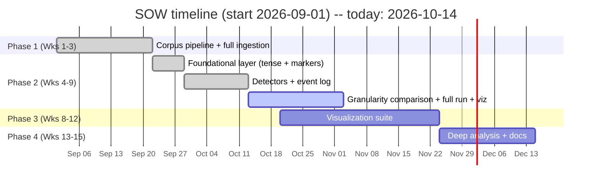
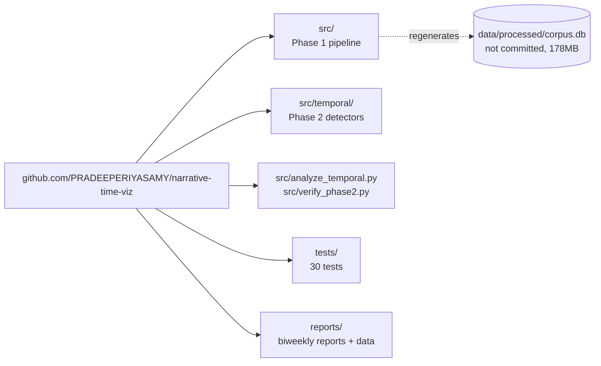
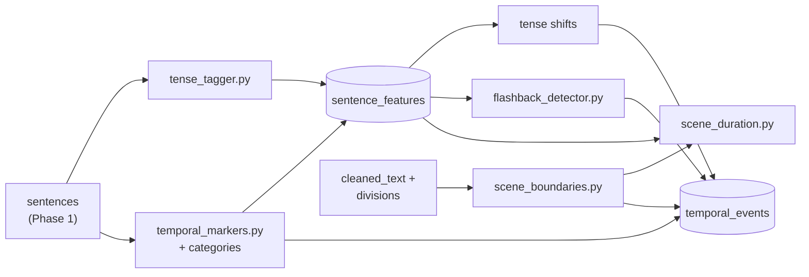
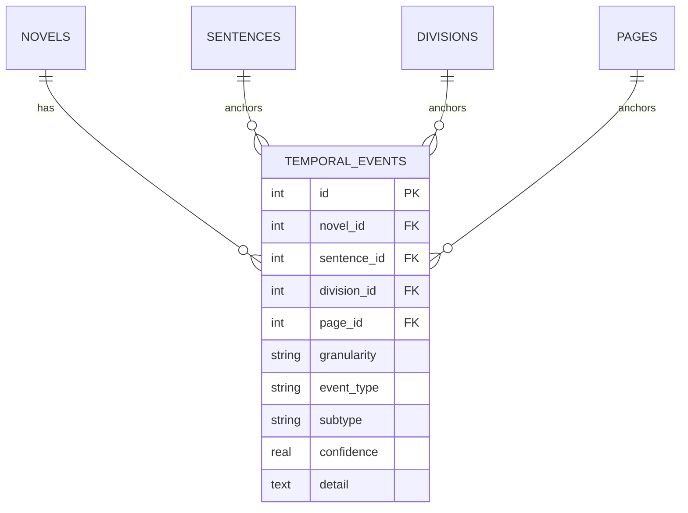
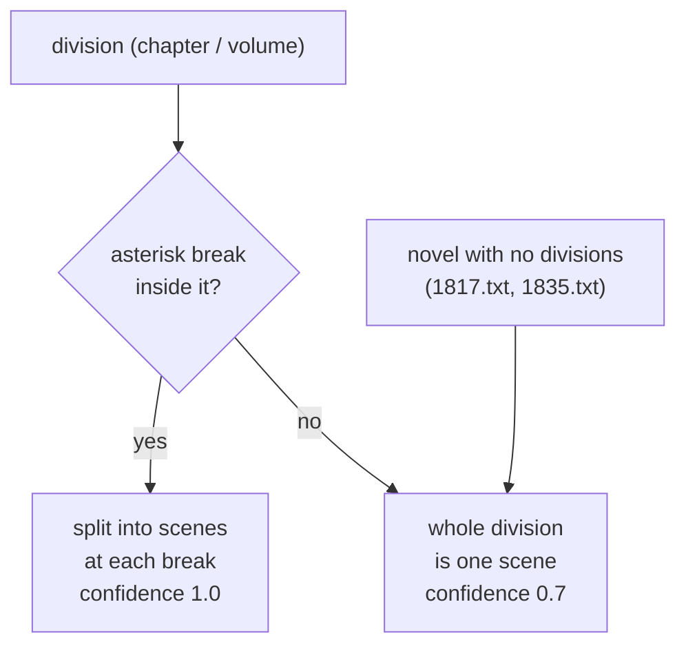
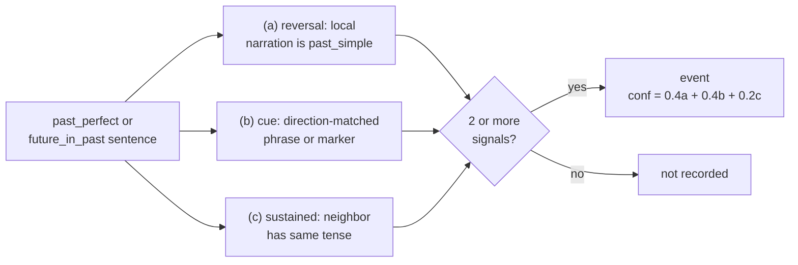
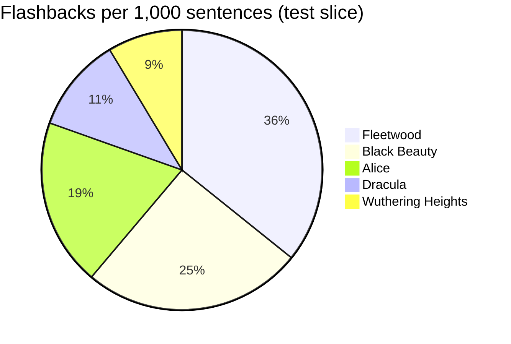
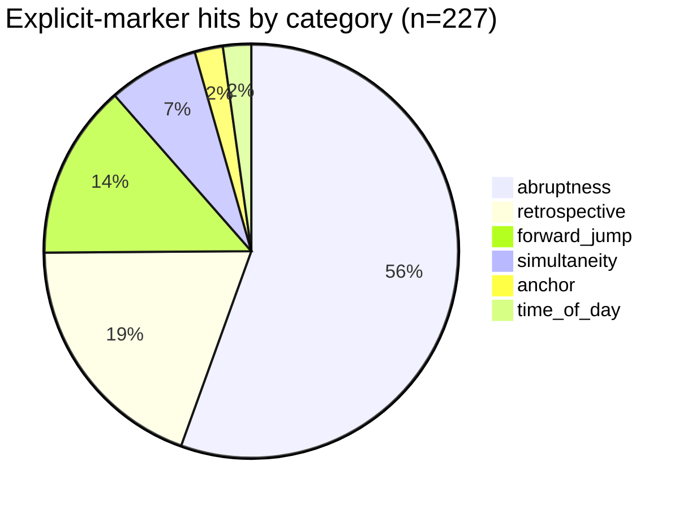

# Weeks 5-6 — Phase 2 detectors built: scene boundaries, scene duration, flashback/flash-forward, and the temporal event log

**Period:** Weeks 5-6 (2026-09-29 to 2026-10-12); report filed 2026-10-14
**SOW phase:** Phase 2 — Temporal Analysis Engine (Weeks 4-9, ~100 hrs), now ~75% complete

## Summary

This period built the detection half of the Phase 2 engine on top of the
tense and marker layer from Weeks 3-4: scene boundary detection, a scene
duration estimate, flashback/flash-forward detection, per-detector
confidence scoring, and the `temporal_events` table, which is the SOW's
per-novel "temporal event log." These are tied together by a CLI
(`analyze_temporal.py`) and an acceptance check (`verify_phase2.py`). The
engine now runs end-to-end on the 5 Phase 2 test novels and detects all four
feature types the SOW's success criteria require: tense shifts, temporal
markers, scene boundaries, and flashbacks/flash-forwards. That's 12,807
events across 24,901 sentences, and the acceptance check passes.

Two findings changed the design while it was being built. First, the 12
marker phrases added untested in Weeks 3-4 ran against real text for the
first time, and **"suddenly" turned out to be 45% of all marker hits**.
"Suddenly" marks an abrupt event, not a skip in story time, so markers are
now grouped by what they actually signal, and each detector reads only the
groups relevant to it. Second, the flashback threshold was set by
measurement rather than intuition: requiring two of three signals flags 4.1%
of sentences, versus 12.7% for one signal and 0.04% for all three. What's
left for Weeks 7-9 is granularity comparison, the full 91-novel run, and
the initial visualizations.

## Timeline

Phase 2 is roughly three-quarters done by duty count and on schedule. Seven
of its nine SOW duties now have working, tested implementations, and three of
its four deliverables are met (see "Current state vs. SOW" below). The
remaining quarter is granularity comparison, the full 91-novel run, and
initial visualizations. That work overlaps Phase 3's start in week 8, as the
SOW's timeline intends.

## Architecture & Code

### Repository structure and commit history

Commits 1-18 cover Phase 1 and the Weeks 3-4 foundational layer (see
`reports/weeks-01-02.md` and `reports/weeks-03-04.md`). This period adds:

| # | Commit | What it added |
|---|---|---|
| 19 | `chore: keep corpus.db out of git` | `.gitignore` — restores the `data/processed/*.db` rule |
| 20 | `feat: categorize temporal markers by what they signal` | `src/temporal/temporal_markers.py` |
| 21 | `feat: scene boundary detection and scene duration estimate` | `src/temporal/scene_boundaries.py`, `src/temporal/scene_duration.py` |
| 22 | `feat: flashback and flash-forward detector` | `src/temporal/flashback_detector.py` |
| 23 | `feat: temporal event log CLI and Phase 2 acceptance check` | `src/temporal/event_log.py`, `src/analyze_temporal.py`, `src/verify_phase2.py` |
| 24 | `test: unit tests for scene, duration, flashback, and marker categories` | `tests/test_temporal.py` |
| 25 | `docs: biweekly progress report for Weeks 5-6` | `reports/weeks-05-06.md` |
| 26 | `docs: update README for Phase 2 detectors` | `README.md` |

`corpus.db` is still a build artifact, not a source file. Its contents for
this period's work, `sentence_features` and `temporal_events`, regenerate
with `python -m src.analyze_temporal --test-slice`.

### Phase 2 engine: from sentence text to the temporal event log

`analyze_temporal.py` runs every box in this diagram for each novel in one
pass and commits per novel. Re-running a novel deletes its old rows first,
the same idempotent pattern `db.py` uses for Phase 1 ingest.

### The temporal event log (`temporal_events`)

Every event carries the sentence, division, and page it falls in, so "which
chapter / which original page is this flashback on" is a plain join. The
SOW's page-anchoring example works directly. In Fleetwood, the one
test-slice novel with dense original pagination, 3,522 of 3,525 events carry
a page number; for instance, a confidence-1.0 flashback ("I remembered with
insupportable anguish the manner in which my absence had been employed")
sits on **page 197 of the original edition**.

| `event_type` | `granularity` | `subtype` | `detail` (JSON) |
|---|---|---|---|
| `tense_shift` | sentence | `from->to`, e.g. `past_simple->past_perfect` | from, to |
| `explicit_marker` | sentence | marker category, e.g. `forward_jump` | phrases, categories |
| `scene_boundary` | division | `asterisk_break` or `division` | words, sentences, jumps, jumps per 1k words, duration label |
| `flashback` / `flashforward` | sentence | — | which signals fired, background tense, cue phrases |

### Scene boundary detection (`scene_boundaries.py`)

This builds directly on the Weeks 3-4 corpus check: the `* * * * *` break is
a real convention in 32/100 novels and survives cleaning intact, while
blank-line runs are not a real convention. An asterisk break is an
unambiguous authorial signal, so it scores 1.0. A new chapter is a structural
boundary that usually, but not always, changes scene, so it scores 0.7.

### Scene duration estimate (`scene_duration.py`)

Each scene_boundary event records two relative quantities:

- **discourse length**: how much text the scene takes up, in words. This is
  how long the *telling* is.
- **forward jumps**: how many `forward_jump` markers ("the next day", "years
  later", "before long") occur inside the scene. This is a rough signal of
  how much *story time* the telling skips across.

A long scene with no jumps reads as continuous, slowed-down narration; a
short scene with several jumps reads as summary. That contrast is the input
Phase 3's pace/density plot needs. The module deliberately does **not**
output an absolute story-time duration (hours, days). Text heuristics can't
compute one reliably, and the methodology write-up will say so plainly
rather than show a fabricated number.

### Flashback / flash-forward detection (`flashback_detector.py`)

Cues are direction-matched. A flashback cue is a `retrospective` marker
("long ago", "ever since") or a recall phrase ("had happened", "she
remembered", "recalled"). A flash-forward cue is a `forward_jump` marker or a
prospective phrase ("would later", "would one day"). Every recorded event
scores 0.6, 0.8, or 1.0. All of them are stored; filtering by confidence is a
query-time choice for Phase 3, not something decided here.

### Temporal-marker categories (`temporal_markers.py`)

| Category | Phrases | Used by |
|---|---|---|
| `forward_jump` | years / months / weeks / days later, the following day, the next day, some time later, not long after, before long, from then on | scene duration; flash-forward cue |
| `retrospective` | years before, long ago, years ago, ever since, in those days, until now | flashback cue |
| `simultaneity` | meanwhile, in the meantime | logged only |
| `time_of_day` | at dawn, at dusk | logged only |
| `anchor` | that same day, by now, it was not until | logged only |
| `abruptness` | suddenly, all at once | logged only |

Every phrase is still logged as an `explicit_marker` event, with its category
as the subtype. The categories only control which phrases count toward scene
duration and flashback cues. Matching is now whole-word, so "by now" no
longer matches inside "standby now".

### Test coverage (`tests/test_temporal.py`)

15 new tests this period, 30 in the suite overall (all passing):

| Test | Verifies |
|---|---|
| `test_temporal_markers_whole_word_only` | "by now" doesn't match inside "standby now" |
| `test_marker_categories` | each category maps correctly; `phrases_in` filters by category |
| `test_scene_break_detected` | an asterisk-break line is found at the right offset |
| `test_scene_break_ignores_inline_asterisks` | `*emphasis*` and stray stars aren't breaks |
| `test_scenes_split_within_division` | one break splits a division into two scenes, sources tagged |
| `test_scenes_one_per_division_without_breaks` | no breaks means one scene per division, spans correct |
| `test_scenes_undivided_novel_is_one_scene` | the 1817/1835 case: no divisions means one scene |
| `test_duration_label` | 0 jumps → "continuous"; N jumps → "spans N explicit jump(s)" |
| `test_jumps_per_1k_words` | density math, including a zero-length scene |
| `test_flashback_reversal_plus_cue` | reversal + retrospective marker fires at 0.8 |
| `test_flashback_reversal_plus_sustained` | two consecutive past-perfect sentences fire at 0.6 each |
| `test_lone_past_perfect_clause_is_not_a_flashback` | reversal alone (ordinary backstory) does **not** fire |
| `test_abruptness_marker_is_not_a_flashback_cue` | "suddenly" + reversal stays below threshold |
| `test_flashforward_detected_from_cue_phrase` | "would later" + reversal fires as flash-forward |
| `test_all_three_signals_score_full_confidence` | reversal + cue + sustained scores 1.0 |

## What was done

- **Built the scene boundary detector** on the asterisk-break convention
  confirmed in Weeks 3-4, with a division-level fallback. It covers both
  undivided novels (1817.txt, 1835.txt) as single-scene texts.
- **Built the scene duration estimate**: discourse length plus forward-jump
  count per scene, recorded on each scene_boundary event. It deliberately
  stops short of claiming an absolute story-time duration.
- **Built the flashback/flash-forward detector** using the three SOW signals
  (tense reversal, cue phrases, sustained framing), requiring at least two to
  fire. The threshold was set by measurement (see "Detector evaluation"
  below).
- **Built the temporal event log**: `event_log.py` writes to
  `temporal_events`, and `analyze_temporal.py` runs every detector per novel.
  Its flags are `--test-slice`, `--novel`, `--limit`, and `--include-partial`;
  the last is off by default, so the 9 single-volume novels stay excluded
  unless that decision changes.
- **Built `verify_phase2.py`**, mirroring `verify.py` for Phase 1. It checks
  that all four required feature types are present, every confidence value is
  in [0, 1], every test-slice sentence is tagged, and no ineligible novel was
  analyzed. It reports granularity comparison as pending instead of silently
  skipping it.
- **Ran the engine on the 5 test novels**: 12,807 events across 24,901
  sentences in about 78 seconds. Both `verify_phase2.py` and Phase 1's
  `verify.py` pass.
- **Grouped temporal markers into categories** after their first real run
  showed "suddenly" made up 45% of hits (see Findings #1), and switched
  matching to whole-word.
- **Spot-read the output against the novels themselves**, at both the
  high-confidence and the bulk confidence tier (see "Detector evaluation"),
  rather than reporting counts alone.
- **Restored the `data/processed/*.db` rule in `.gitignore`.** It had dropped
  out of the committed history, which meant a stray `git add .` would have
  picked up the 178MB database.

## Decisions made

- **Two-of-three signals for flashback detection.** Measured on the test
  slice: a one-signal rule flags 12.7% of all sentences. A lone past-perfect
  clause in past-tense narration satisfies "tense reversal" almost by
  definition, so one signal mostly catches ordinary backstory. Requiring all
  three signals catches only 11 sentences in nearly 25,000. Two signals (4.1%)
  is the workable middle.
- **Markers grouped by function, with each detector reading only its own
  groups.** Flashbacks use retrospective cues, flash-forwards use forward-jump
  cues, and scene duration counts forward jumps only. Every phrase is still
  logged, so nothing is thrown away; the categories only decide what counts
  as evidence for what.
- **Scene boundary confidence reflects the evidence type.** Asterisk breaks
  score 1.0 (explicit authorial signal) and chapter starts score 0.7. A
  chapter break usually changes scene but isn't guaranteed to, and a flat
  1.0 would overstate it.
- **Tense-shift confidence takes the weaker endpoint.** A shift between two
  sentences is scored by the less certain of the two tense classifications,
  since the shift can't be more certain than either side of it.
- **No absolute story-time duration.** The SOW says "approximate." The
  honest approximation is relative (discourse length versus forward jumps),
  not a number of days the heuristics can't support.
- **Granularity comparison held for Weeks 7-9, not started early.** It needs
  every detector's output in place and stable first; comparing sentence- and
  division-level views of events that are still changing would have to be
  redone anyway.

## Current state vs. SOW (Phase 2)

| Duty | Status |
|---|---|
| Tense tracking | **Done**: per-sentence tense (Weeks 3-4) plus `tense_shift` events with confidence |
| Explicit temporal markers | **Done**: 25 phrases in 6 categories, whole-word matching. Calendar dates/clock times not yet covered (Findings #3) |
| Scene boundary detection | **Done**: asterisk breaks plus division fallback, confidence by evidence type |
| Flashback/flash-forward patterns | **Done**: 3 SOW signals, 2-of-3 rule, direction-matched cues |
| Scene duration estimation | **Done** as a relative estimate (discourse length versus forward jumps); no absolute duration, by design |
| Confidence scoring | **Done**: every event type scored, all values in [0, 1], verified |
| Page-level leverage | **Done** for the reliable-pagination novels: every event carries its page (Fleetwood: 3,522/3,525 page-anchored) |
| Multi-granularity analysis | **Partial**: events are recorded at sentence and division granularity; side-by-side comparison is pending |
| Granularity comparison | **Weeks 7-9** |

| Deliverable | Status |
|---|---|
| Temporal analysis engine (Python module) | **Done**: `src/temporal/` plus `src/analyze_temporal.py` |
| Structured output per novel (JSON/SQLite "temporal event log") | **Done**: `temporal_events`, with JSON `detail` per event |
| Working analysis for at least 5 test novels | **Done**: all 5, `verify_phase2.py` passing |
| Initial visualizations for those 5 novels | **Weeks 7-9** |

Seven of nine duties are done, one is partial, and one is scheduled, so
Phase 2 is roughly 75% complete. The SOW success criterion "temporal
analysis engine detects at least 4 feature types: tense shifts, temporal
markers, scene boundaries, flashbacks/flash-forwards" is met on the test
slice.

## Findings / deviations from the SOW

1. **"Suddenly" dominated the explicit-marker signal.** On first contact with
   real text, 104 of 229 marker hits (45%) were "suddenly". Counted as a
   time jump, it inflated scene duration: one Dracula chapter showed 11
   "jumps", where the category fix brings the per-scene maximum down to 2.
   Counted as a flashback cue, it added noise. The categories in
   `temporal_markers.py` fix both without dropping any data.
2. **Forward-jump markers are rarer than the SOW's examples suggest.**
   Phrases like "three years later" and "the following day" appear only 31
   times across nearly 25,000 test-slice sentences. As a result, most scenes
   score "continuous" (Wuthering Heights and Alice: every scene). Explicit
   jump phrases alone are a thin signal for story-time duration. The
   discourse-length side of the estimate carries more of the weight, and
   that should be named as a limitation.
3. **Dracula's dates aren't detected.** Dracula was picked for the test
   slice because it's epistolary with in-text dates. It has 191 calendar
   dates ("3 May", "1st May") and 60 clock times. The phrase-based marker
   module was never designed to catch these, and it catches none. This is the
   clearest gap in explicit-marker coverage: adding a date/time pattern
   detector is a natural extension in Weeks 7-9 and fits the SOW's "explicit
   temporal markers" duty directly.
4. **Most flashback detections rest on tense evidence alone.** Of 831
   flashbacks, 794 (96%) fired on reversal + sustained with no cue phrase.
   Only 37 have a cue. The cue-supported tier (confidence ≥ 0.8) is the
   high-precision subset. The 0.6 tier is better read as a density of
   retrospective reference than as discrete flashback scenes (see "Detector
   evaluation").
5. **Present tense is a strong genre signal.** Present tense makes up 23.7%
   of Dracula's sentences and 20.3% of Wuthering Heights', against 6-7% in
   Alice and Black Beauty. That fits diary/letter form and dialogue-heavy
   frame narration respectively. It also means tense shifts in those two
   novels are dominated by narration ↔ dialogue alternation, which matters for
   how the tense-shift plot gets read in Phase 3.

## Detector evaluation (test slice)

Counts alone don't show whether detections are right, so this section reads
the output against the novels as well as summarizing it.

### Results per novel

| Novel | Sentences | Tense shifts | Markers | Scene bounds | Flashbacks | Flash-fwds | High-conf (≥0.8) |
|---|---|---|---|---|---|---|---|
| 1805 *Fleetwood* (Godwin) | 6,524 | 2,965 | 26 | 56 | 426 | 52 | 10 |
| 1847 *Wuthering Heights* (E. Brontë) | 6,816 | 3,282 | 43 | 38 | 107 | 43 | 7 |
| 1865 *Alice's Adventures in Wonderland* (Carroll) | 965 | 389 | 17 | 11 | 34 | 6 | 6 |
| 1877 *Black Beauty* (Sewell) | 1,989 | 876 | 26 | 52 | 92 | 31 | 6 |
| 1897 *Dracula* (Stoker) | 8,607 | 3,879 | 110 | 26 | 172 | 48 | 10 |
| **Total** | **24,901** | **11,391** | **222** | **183** | **831** | **180** | **39** |

Fleetwood leads by a wide margin, as it should. It's a first-person memoir
narrated almost entirely in retrospect, and it also has the highest
past-perfect share of any test novel (15.0% of sentences). Wuthering
Heights' frame narration is retrospective at the level of the whole story,
but Nelly Dean tells most of it in plain past tense rather than past
perfect. A tense-based detector sees the frame's entry points, not the
entire embedded story, and that's a real limit worth stating.

### Dominant tense share (% of sentences)

| Novel | past_simple | past_perfect | present | present_perfect | future_in_past | other |
|---|---|---|---|---|---|---|
| Fleetwood | 49.5 | 15.0 | 15.5 | 7.3 | 3.7 | 9.0 |
| Wuthering Heights | 47.8 | 6.3 | 20.3 | 4.6 | 5.5 | 15.5 |
| Alice | 65.7 | 11.2 | 6.0 | 3.4 | 6.3 | 7.4 |
| Black Beauty | 62.8 | 11.6 | 6.9 | 6.4 | 7.4 | 4.8 |
| Dracula | 42.8 | 6.9 | 23.7 | 8.3 | 3.8 | 14.5 |

### Flashback threshold, measured

| Rule | Detections | % of sentences |
|---|---|---|
| any 1 signal | 3,163 | 12.7% |
| **2 of 3 signals (chosen)** | **1,011** | **4.1%** |
| all 3 signals | 11 | 0.04% |

### Which signals fired

| Signal combination | Flashbacks | Flash-forwards | Confidence |
|---|---|---|---|
| reversal + sustained | 794 | 178 | 0.6 |
| reversal + cue | 26 | 2 | 0.8 |
| reversal + cue + sustained | 11 | 0 | 1.0 |

### Confidence distribution by event type

| Event type | 0.6 | 0.7 | 0.8 | 1.0 |
|---|---|---|---|---|
| tense_shift | 8,358 | — | — | 3,033 |
| explicit_marker | — | — | — | 222 |
| scene_boundary | — | 178 | — | 5 |
| flashback | 794 | — | 26 | 11 |
| flashforward | 178 | — | 2 | — |

73% of tense shifts score 0.6 because at least one endpoint sentence holds
more than one verb pattern, which is normal for long 19th-century sentences.
The 5 confidence-1.0 scene boundaries are Wuthering Heights' 5 asterisk
breaks; it's the only test-slice novel that uses the convention.

### Reading the high-confidence tier

Confidence-1.0 flashbacks, as they appear in the novels:

| Novel | Sentence (trimmed) | Cue |
|---|---|---|
| Wuthering Heights | "It was the same room into which he had been ushered, as a guest, eighteen years before…" | years before |
| Wuthering Heights | "…the same horror and detestation of his ancient enemy that had occupied his heart ever since Mrs. Linton's death." | ever since |
| Fleetwood | "We fancied … that we could see the mark among the tufts of grass, where my foot had slipped thirty years before." | years before |
| Fleetwood | "I remembered with insupportable anguish the manner in which my absence had been employed." | i remembered |
| Alice | "…Alice had no very clear notion how long ago anything had happened." | had happened, long ago |
| Dracula | "…I remembered how quiet he had been just before he attacked me in my own study…" | i remembered |

These are genuine retrospective passages. One false-positive pattern did
appear: **"recalled" used in its "brought back" sense** ("This spectacle
recalled me to the reality of things about me"). That's a polysemy limit of
literal cue matching, noted for the methodology doc.

### Reading the bulk 0.6 tier

A random sample of 0.6-confidence flashbacks shows a mix. Some are real
backstory ("He had been the longest on that stand of any of the men" — Black
Beauty). Others are past-perfect subordinate clauses inside ongoing narration
("the flies … settled on my bleeding flanks where the spurs had dug in").
The practical reading for Phase 3: **plot ≥0.8 as discrete flashback
annotations and 0.6 as a density curve of retrospective reference**, rather
than drawing all 1,011 as equally confident events.

### Marker categories, test slice

| Phrase | Hits | Category |
|---|---|---|
| suddenly | 104 | abruptness |
| all at once | 22 | abruptness |
| the next day | 21 | forward_jump |
| ever since | 16 | retrospective |
| long ago | 16 | retrospective |
| meanwhile | 10 | simultaneity |
| before long | 10 | forward_jump |
| in the meantime | 6 | simultaneity |
| years before | 5 | retrospective |
| years ago | 5 | retrospective |
| by now | 5 | anchor |
| at dawn | 3 | time_of_day |
| in those days | 2 | retrospective |
| at dusk | 2 | time_of_day |

Category hits (227) exceed explicit_marker events (222) because a few
sentences contain two phrases and are logged once. Eleven of the 25 phrases
had zero hits in this 5-novel slice; the full-corpus run in Weeks 7-9 will
show whether they earn their place.

### Scenes per novel

| Novel | Scene boundaries | Asterisk / division | Median scene (words) | Continuous | With forward jumps |
|---|---|---|---|---|---|
| Fleetwood | 56 | 0 / 56 | 2,422 | 54 | 2 |
| Wuthering Heights | 38 | 5 / 33 | 3,139 | 38 | 0 |
| Alice | 11 | 0 / 11 | 2,162 | 11 | 0 |
| Black Beauty | 52 | 0 / 52 | 1,149 | 41 | 11 |
| Dracula | 26 | 0 / 26 | 5,890 | 16 | 10 |

Black Beauty's short, episodic chapters (median 1,149 words) and Dracula's
long, date-driven ones (median 5,890) carry the most forward jumps, which
fits their structure. Dracula's count would rise sharply once dated diary
entries are detected (Findings #3).

## Open items / needs supervisor input

Carried forward. Still open, and not decided unilaterally:

- **Multi-volume novel treatment**: the 9 single-volume novels stay excluded
  by default (`analysis_eligible = 0`, and `--include-partial` is off by
  default). This needs Shawna's confirmation versus include-with-caveat.
- **Page-level visualization scope**: still the 6-novel reliable-pagination
  subset. This period shows the mechanism working end-to-end on Fleetwood.
- **Bracket-wrapped apparatus text** cleanup timing is still open.

New this period:

- **How flashbacks should be presented to readers.** The data supports
  showing ≥0.8 detections as discrete events and the 0.6 tier as a density
  curve. This is worth a quick check with Shawna before Phase 3 fixes the
  visual encoding, since it shapes how the flashback map reads to an
  English-department audience.

## Next steps (Weeks 7-9, the remaining ~25% of Phase 2)

- **Granularity comparison**: for each event, record whether it is still
  visible at division and page granularity, answering the SOW's "shows up at
  one level but gets washed out at another" question with the
  `granularity_comparison` table already in place.
- **Date/time marker detection**: calendar dates and clock times
  (Findings #3), starting from Dracula's 191 dates and 60 times as the test
  case.
- **Full 91-novel run** of `analyze_temporal.py`, then re-check the marker
  categories and the flashback threshold at corpus scale.
- **Initial visualizations for the 5 test novels** (SOW Phase 2
  deliverable), overlapping Phase 3's start in week 8.
- Bring the open items above to the next check-in.
