# Weeks 7-8 — Phase 2 complete: multi-granularity comparison, absolute time, the full 91-novel run, and first findings

**Period:** Weeks 7-8 (2026-10-13 to 2026-10-26); report filed 2026-10-27
**SOW phase:** Phase 2 — Temporal Analysis Engine (Weeks 4-9) — **complete**, one week ahead of the SOW's week-9 close; Phase 3 (Weeks 8-12) begun through Phase 2's initial visualizations

## Summary

Phase 2 is finished. This period built the piece of the engine the SOW
singles out as its methodological contribution: **multi-granularity
comparison**. Every one of four temporal signals (retrospection,
prospection, temporal-marker density, tense churn) is now measured at four
scales: 25-word bins, 10-sentence passages, scenes, and, for the novels
with reliable pagination, the original printed page. Every detected event
records whether it still stands out at each scale. The period also closed
the gap the Weeks 5-6 report flagged, with calendar dates and clock times
now detected (Dracula's dated entries went from invisible to the main
driver of its story-time estimate). The engine then ran across all 91
analysis-eligible novels: 571,878 sentences, 12.4 million words, and
**313,332 temporal events**, every one with its granularity comparison.
`verify_phase2 --require-full` passes. The SOW's initial visualizations
for the 5 test novels are delivered as static figures and interactive
Plotly pages.

With a full corpus to read, the first findings came in. Four stand out:

1. **The flashback that disappears.** Of the flashbacks that stand out at
   word level, **72% vanish at scene level**. A chapter-scale reading of
   narrative time, the scale most distant reading works at, misses most
   of the retrospective moments a sentence-scale reading sees. That is
   the SOW's own question ("does the same temporal event show up at
   word-level but get washed out at page-level?"), answered with a
   number.
2. **Retrospection across the century: the grammar holds steady, the
   signposting grows.** A naive reading of the data says Victorian novels
   look back less as the century goes on. That turns out to be an
   artifact of sentences getting shorter. Once sentence length is
   controlled for, the amount of past-perfect retrospection shows no
   trend. What does rise, robustly, is retrospection that is
   *announced*: cue-marked flashbacks and phrases like "long ago" and
   "ever since".
3. **"Suddenly" is the century's growth word** among temporal markers. It
   jumps in the 1880s, and it concentrates in the supernatural, gothic, and
   scientific-romance novels of the corpus.
4. **The engine finds literary form on its own.** It surfaced the diary
   novels (*The Diary of a Nobody*, *Dracula*, *The Tenant of Wildfell
   Hall*), the one present-tense novel (Broughton's *Red as a Rose is
   She*), and the single chapter in which Carroll stops the clock (the Mad
   Tea-Party), each without being told to look.

These are heuristic measurements, offered as evidence for close reading to
test rather than as conclusions. Where a number could mislead, the report
says so, including one apparent finding retracted after checking.

## Timeline

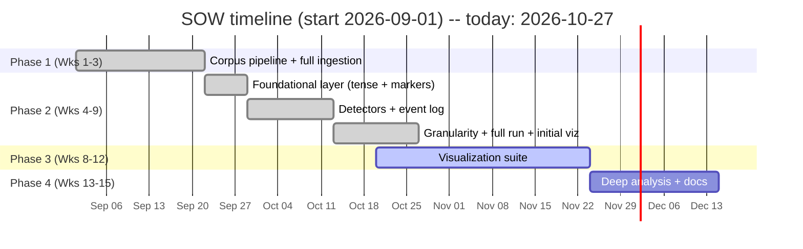

Phase 2 closes in week 8 of its week 4-9 window. Phase 3 is marked active
because the SOW has the two phases overlap from week 8 "so visualization
development can begin as early novels are analyzed". The initial figures
and interactive pages in this report are that beginning. The dashboard
itself is the Phase 3 work ahead.

## Architecture & Code

### Repository structure and commit history

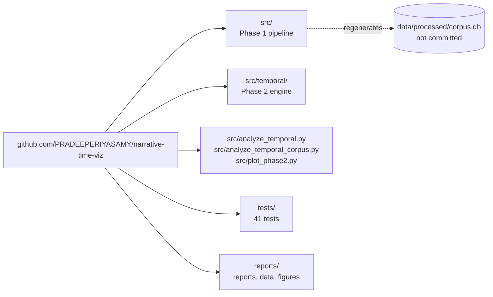

Commits 1-26 cover Phase 1 and Phase 2 through Weeks 5-6. This period
adds:

| # | Commit | What it added |
|---|---|---|
| 27 | `feat: detect calendar dates and clock times` | `src/temporal/temporal_markers.py`, `src/temporal/scene_duration.py` |
| 28 | `feat: word-level positions for tense constructions` | `src/temporal/tense_tagger.py` |
| 29 | `feat: multi-granularity signals and granularity comparison` | `src/temporal/granularity.py`, `src/db.py` |
| 30 | `feat: run granularity comparison in the temporal engine` | `src/analyze_temporal.py`, `src/verify_phase2.py` |
| 31 | `test: time references, word positions, and granularity comparison` | `tests/test_temporal.py` |
| 32 | `feat: corpus-level temporal analysis` | `src/analyze_temporal_corpus.py`, `requirements.txt`, `reports/data/temporal_*` |
| 33 | `feat: Phase 2 initial visualizations` | `src/plot_phase2.py`, `reports/figures/phase2/` |
| 34 | `docs: biweekly progress report for Weeks 7-8` | `reports/weeks-07-08.md` |
| 35 | `docs: update README for Phase 2 completion` | `README.md` |

`corpus.db` remains a build artifact. Everything in this report
regenerates with three commands (see "How to reproduce", below).

### The complete Phase 2 engine

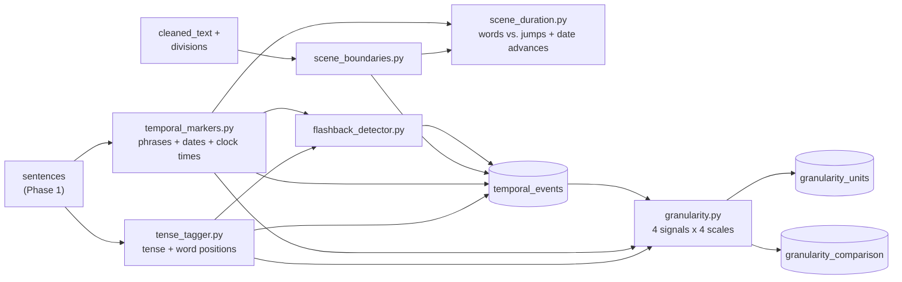

One pass per novel, committed per novel, idempotent on re-run. The full
91-novel run took **1 hour 48 minutes** (6,505 s) on one laptop CPU core.
The 5-novel test slice takes under a minute. The Weeks 5-6 report expected
the full run to be much faster. The extra time is spent on spaCy tagging
plus writing about 873,000 granularity rows, and it doesn't matter for a
run done once per corpus revision.

### Multi-granularity comparison (`granularity.py`)

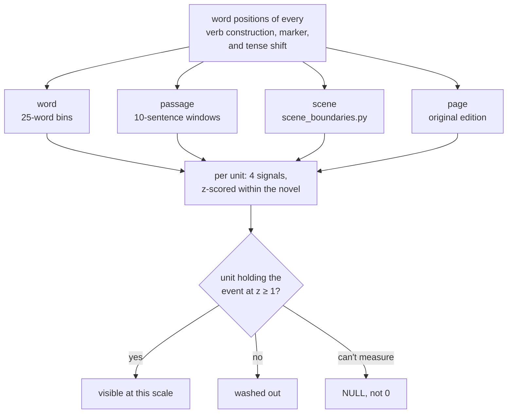

| Signal | Measures | Compared for |
|---|---|---|
| retrospection | past-perfect constructions / all verb constructions | flashbacks |
| prospection | future-in-past ("would" + verb) / all verb constructions | flash-forwards |
| marker density | temporal markers per 1,000 words | explicit markers |
| tense churn | tense shifts per 1,000 words | tense shifts |

| Scale | Unit | Median unit size | Available for |
|---|---|---|---|
| word | fixed 25-word bin | 25 words | all 91 novels |
| passage | 10 consecutive sentences | 192 words | all 91 novels |
| page | one page of the original edition | 170 words | the 5 eligible novels with reliable pagination |
| scene | asterisk break or division | 2,821 words | all 91 novels |

Three design points matter for reading the results:

- **Visibility is relative to the novel itself.** A unit is "visible" when
  its signal is at least one standard deviation above that novel's own
  average at that scale. A flashback in a pervasively retrospective novel
  (Fleetwood, a memoir told in retrospect) has to stand out against more
  retrospection than one in a novel narrated largely in the present.
- **Each event sits at its defining evidence:** a flashback at its
  past-perfect verb, a marker event at the marker, a tense shift at the
  first verb of its new tense. Word-level visibility therefore tests the
  sharpest available view of the event.
- **NULL means "not measurable", never "washed out".** That covers novels
  without pages and scales with fewer than 5 units to compare against.

### Why a 10-sentence passage, not a paragraph

The SOW's middle scale is "sentence/paragraph". Paragraph breaks survive
in only **64 of the 91** analyzable novels. In the rest, the source files
flattened them: *Wuthering Heights* has 34 blank-line blocks for 34
chapters, and *Pride and Prejudice* has 124 in 121,000 words. A paragraph
scale would mean a real paragraph in some novels and a whole chapter in
others. A fixed 10-sentence passage means the same thing everywhere, and
its median (192 words) is close to a typical 19th-century paragraph.

### Database additions

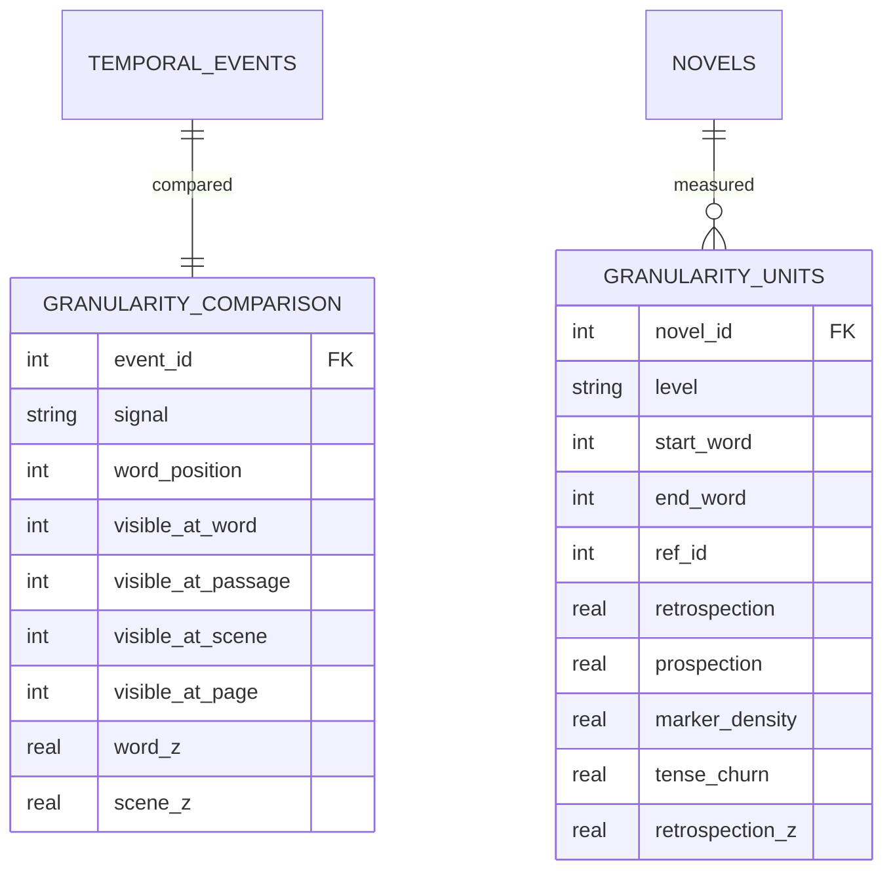

`granularity_units` holds every signal at every scale: 559,625 rows for
the corpus (496,963 word bins, 57,230 passages, 3,812 scenes, 1,620
pages), the series Phase 3's pace and density plots will draw from.
`granularity_comparison` replaces the placeholder table created in Weeks
3-4, which had never held a row. The migration only runs if that table is
still empty, so it can't discard data.

### Absolute time references (`temporal_markers.py`)

| Category | Examples matched | Corpus total |
|---|---|---|
| calendar date | "3 May", "1st of May", "May 3rd", normalized to (month, day) | 603 |
| clock time | "8:35 P. M.", "ten o'clock", "half-past nine" | 1,444 |

The formats came from the real text first, starting with Dracula's diary
headers ("3 May.-I found..."). Month names are matched case-sensitively,
so the verb "may" never counts, and "May 1885" isn't read as a day. When a
date moves forward ("3 May" ... "4 May"), that now counts as a story-time
jump in the scene-duration estimate. This changed Dracula completely: its
26 scenes went from 16 rated "continuous" to 1. Its jumps are 130 date
advances and only 12 jump phrases, with up to 19 jumps in a single chapter.

### Test coverage (`tests/test_temporal.py`)

11 new tests this period, 41 in the suite overall (all passing):

| Test | Verifies |
|---|---|
| `test_constructions_carry_char_offsets` | each verb construction knows where it is ("had" and "arrived" located) |
| `test_calendar_dates_found_and_normalized` | "3 May", "1st of May", "June 2nd" → (5, 3), (5, 1), (6, 2) |
| `test_clock_times_found` | "8:35 P. M.", "ten o'clock", "half-past nine" |
| `test_modal_may_and_years_are_not_dates` | "may 3 times", "May 1885" are not dates |
| `test_date_movements` | first / advance / same / regress across a diary sequence |
| `test_word_and_passage_units_cover_the_text` | units tile the text with no gaps or overlaps |
| `test_measure_computes_signals_and_zscores` | a past-perfect burst scores retrospection 1.0 and z > 1 |
| `test_local_flashback_washes_out_at_coarser_levels` | a sharp burst is visible at word level and washed out at scene level |
| `test_too_few_units_is_not_measurable` | fewer than 5 units gives NULL, not 0 |
| `test_visibility_zero_when_unit_does_not_stand_out` | an ordinary unit scores 0 |
| `test_scene_boundaries_are_structural` | boundaries are compared as structure, not as a rate |

The wash-out test builds the exact situation the corpus shows. A sharp
flashback is the most retrospective moment at word level, but it's
averaged into a scene that's less retrospective overall than a long,
mildly retrospective stretch earlier in the novel.

## What was done

- **Built multi-granularity measurement and comparison**
  (`granularity.py`): 4 signals × 4 scales, z-scored within each novel,
  with a visibility verdict (or NULL) for every event at every scale.
- **Gave the tense tagger word-level positions**: every verb construction
  now carries its location, so word-scale density is measured from the
  constructions themselves rather than from one tense label per sentence.
- **Closed the absolute-time gap** from Weeks 5-6: calendar dates and
  clock times are detected, and date advances feed the scene-duration
  estimate.
- **Ran the complete engine on all 91 analysis-eligible novels.**
  `verify_phase2 --require-full` passes: every required event type is
  present, every confidence value is in range, every event has exactly one
  comparison row, every novel has its scales, and no single-volume novel
  was analyzed.
- **Built the corpus-level analysis** (`analyze_temporal_corpus.py`):
  a per-novel table (`reports/data/temporal_novel_stats.csv`, 91 rows) and
  corpus findings (`reports/data/temporal_corpus_summary.json`). It
  includes a corpus-scale re-check of the flashback threshold, trends
  across the century, and author-gender comparisons, with sentence-length
  control and multiple-comparison correction built in.
- **Produced the Phase 2 initial visualizations** for the 5 test novels
  (static figures plus interactive pages), and corpus figures for this
  report (`plot_phase2.py`).
- **Checked findings against the novels themselves** before reporting
  them: Broughton's present tense, Carroll's tea party, Trollope's
  "would", and the sentences behind the highest-confidence detections.
- **Retracted one apparent finding.** The decline in retrospection across
  the century didn't survive a sentence-length check (Findings #2).

## Decisions made

- **A fixed 10-sentence passage as the middle scale**, because paragraph
  breaks survive in only 64 of 91 novels (see above).
- **Visibility at z ≥ 1 within the novel.** It's simple, the same for
  every signal and scale, and relative to each novel's own style, so a
  memoir and a present-tense novel are each judged against themselves.
- **NULL for "can't measure"**, so a novel with no pages never counts as
  washing out every flashback at page level.
- **Page level only where pagination is reliable**: the 5 eligible novels
  whose page markers are dense enough to be real pages (Phase 1 report).
- **Sentence length controlled in every trend test.** Mean sentence length
  halves across the century (ρ = −0.65 with year). Any per-sentence rate
  inherits that decline, whatever the narrative is doing. Each trend is
  reported raw and as a partial correlation with sentence length removed.
- **Bonferroni correction across the trend and gender tests.** Only
  results that survive it are called findings; the rest are labeled
  suggestive.
- **Decade medians, not means, in the figures.** A handful of novels are
  extreme (*The Diary of a Nobody* has 40 dates per 10,000 words), and a
  mean would let one book stand for its decade.
- **The flash-forward signal is reported as prospection, not prolepsis**
  (Findings #7). The name stays in the event log for continuity with the
  SOW, but the analysis says what it measures.

## Current state vs. SOW (Phase 2)

| Duty | Status |
|---|---|
| Tense tracking | **Done**: per-sentence tense, tense-shift events, word-level construction positions |
| Multi-granularity analysis | **Done**: 4 signals at word, passage, scene, and page scale for every novel (page where reliable) |
| Page-level leverage | **Done**: page-anchored events and a page scale for the 5 reliably paginated eligible novels |
| Explicit temporal markers | **Done**: 25 phrases in 6 categories, plus calendar dates and clock times |
| Scene boundary detection | **Done**: asterisk breaks plus division fallback; 3,910 scenes across 91 novels |
| Flashback/flash-forward patterns | **Done**: 3 SOW signals, 2-of-3 rule, re-checked at corpus scale |
| Scene duration estimation | **Done** as a relative estimate: discourse length vs. jump phrases and date advances |
| Confidence scoring | **Done**: every event scored in [0, 1], verified |
| Granularity comparison | **Done**: every one of 313,332 events compared across all four scales |

| Deliverable | Status |
|---|---|
| Temporal analysis engine (Python module) | **Done**: `src/temporal/` + `src/analyze_temporal.py` |
| Structured output per novel (JSON/SQLite "temporal event log") | **Done**: `temporal_events` + `granularity_comparison`, JSON detail per event |
| Working analysis for at least 5 test novels | **Done**, and for all 91 analysis-eligible novels |
| Initial visualizations for those 5 novels | **Done**: `reports/figures/phase2/` (static and interactive) |

| SOW success criterion | Status |
|---|---|
| Engine detects at least 4 feature types (tense shifts, temporal markers, scene boundaries, flashbacks/flash-forwards) | **Met** across the full corpus |
| Output structured (JSON/SQLite) and reproducible for any novel in the corpus | **Met** for all 91 eligible novels. The 9 single-volume novels run with `--include-partial` if Shawna decides to include them (Open items) |

## Findings

Every number below comes from `reports/data/temporal_corpus_summary.json`
and `reports/data/temporal_novel_stats.csv`, both regenerated by one
command. Rates are heuristic detections. Correlations are Spearman's ρ
with publication year across 91 novels. "Robust" means the trend holds
with sentence length controlled and survives Bonferroni correction
(threshold p < 0.0033 across 15 tests).

### 1. The flashback that disappears: what scale does to narrative time

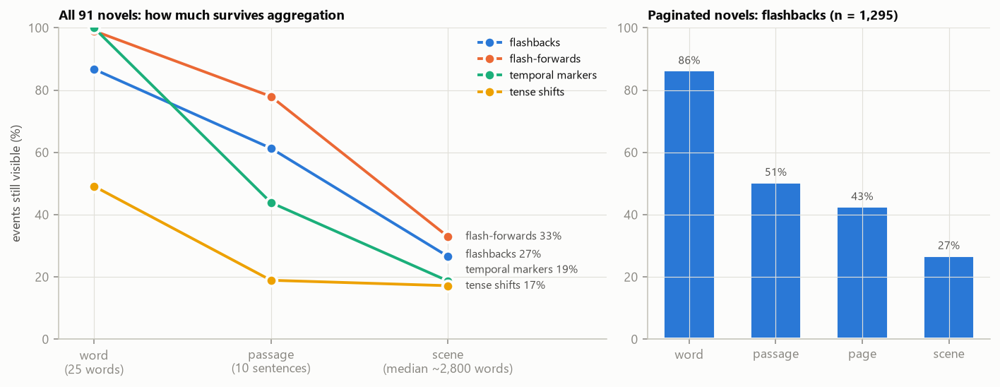

| Signal (events) | Word | Passage | Scene | Page* |
|---|---|---|---|---|
| retrospection (26,588 flashbacks) | 87% | 62% | 26% | 45% |
| prospection (4,519 flash-forwards) | 99% | 79% | 34% | 66% |
| marker density (8,925 marker sentences) | 100% | 85% | 28% | 83% |
| tense churn (269,481 tense shifts) | 49% | 19% | 18% | 21% |

\* page scale: only the 5 reliably paginated novels (1,267 flashbacks).

Of the 23,260 flashbacks that stand out at word level, **8,421 (36%) are
gone by passage scale and 16,827 (72%) by scene scale**. The
high-confidence, cue-marked flashbacks behave the same way (84% → 49% →
22%). They aren't immune to aggregation just because a phrase announces
them.

In Genette's terms, much analepsis in the 19th-century novel is
*internal and local*: a clause or two of the past folded into the
present of the scene. It saturates the sentence and is nearly invisible
at chapter scale. The finding matters well beyond this project. Any
quantitative account of narrative time pitched at the chapter or scene
(the default unit of much distant reading) will systematically
under-count retrospection, and the scale chosen decides which novels look
"retrospective".

Two further observations:

- **The physical page sits between passage and scene.** On the same 1,267
  flashbacks in the paginated novels, visibility runs 89% (word) → 47%
  (passage) → 45% (page) → 27% (scene). A printed page of these early
  editions (median 170 words) behaves like a passage, not like a scene. The
  SOW's "page level" is a fine-grained view in these novels, not a coarse
  one.
- **Tense shifts are ambient, not local.** Only 49% stand out even at word
  scale, because shifts between past, present, and perfect occur in every
  stretch of dialogue-bearing prose. Where they cluster is a weaker signal
  than where retrospection clusters.

The per-novel picture shows the same pattern in each test novel:

| Novel | Flashbacks | Word | Passage | Scene | Page |
|---|---|---|---|---|---|
| *Fleetwood* (Godwin, 1805) | 426 | 90% | 53% | 24% | 58% |
| *Wuthering Heights* (E. Brontë, 1847) | 107 | 100% | 89% | 29% | — |
| *Alice's Adventures in Wonderland* (Carroll, 1865) | 34 | 97% | 59% | 29% | — |
| *Black Beauty* (Sewell, 1877) | 92 | 100% | 72% | 46% | — |
| *Dracula* (Stoker, 1897) | 172 | 98% | 75% | 32% | — |

*Wuthering Heights* holds its flashbacks unusually well at passage scale
(89%). Its retrospective moments arrive in concentrated runs, which fits a
frame narrative whose returns to the past are made by a narrator telling a
story. *Fleetwood*, a memoir retrospective throughout, loses the most at
passage scale (53%): when everything looks back, a single look back stands
out less.

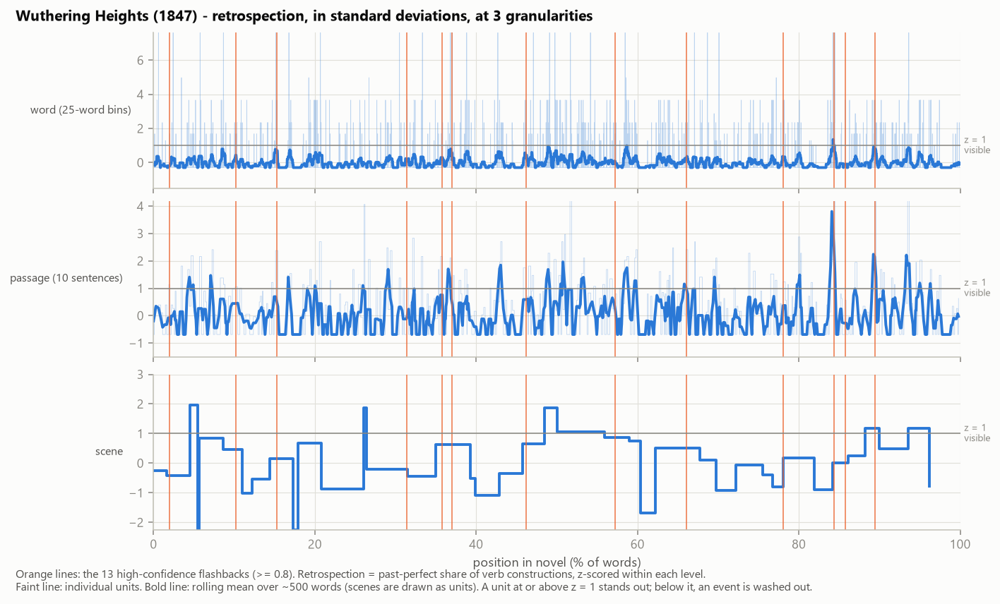

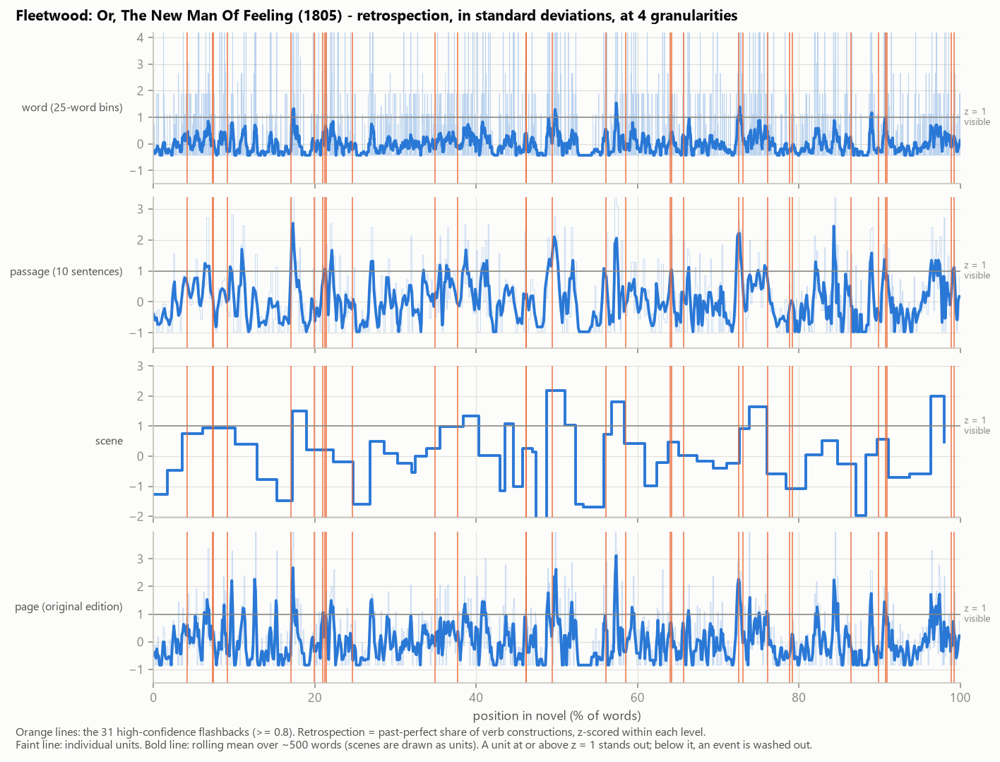

### 2. Retrospection across the century: the grammar holds steady, the signposting grows

The tempting headline is that **Victorian novels look back less as the
century goes on**. Past-perfect sentences fall from 17-20% of sentences in
the 1800s-1820s to about 9-12% after mid-century (ρ = −0.45), and
flashbacks per sentence fall with them (ρ = −0.43).

**That headline doesn't survive checking.** Mean sentence length halves
across the century, from 33-36 words in the 1800s-1820s to 15 in the 1890s
(ρ = −0.65). A long sentence holds more verbs, so it's more likely to
contain some past-perfect clause. With sentence length controlled, the
"decline" disappears (partial ρ = +0.08, p = 0.47). Past-perfect share of
*verbs*, which doesn't depend on sentence length, shows no significant
trend either way. The engine shows Victorian sentences shortening, not
retrospection receding.

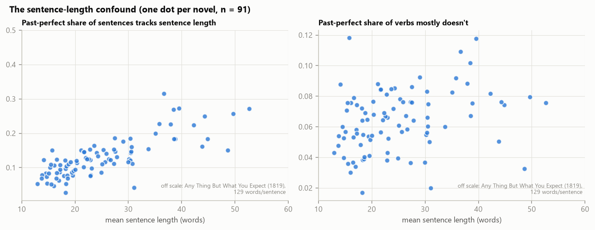

What does change, robustly, is how often retrospection is *announced*:

| Measure | ρ with year | With sentence length controlled | Robust? |
|---|---|---|---|
| Retrospective phrases ("long ago", "years ago", "ever since", "in those days") per 10k words | +0.47 | +0.42 (p = 0.00004) | **yes** |
| Cue-marked flashbacks per 10k words | +0.35 | +0.34 (p = 0.001) | **yes** |
| Past-perfect share of verbs | −0.20 | +0.03 (p = 0.81) | no trend |
| Flashbacks per 10k words (all confidence levels) | −0.09 | +0.12 (p = 0.27) | no trend |

Retrospective phrases roughly double across the century (decade medians
0.85 → 1.86 per 10k words). The grammatical texture of looking back holds
steady, while the explicit vocabulary of looking back grows. One
hypothesis for close reading: as the narrator's retrospective summary
gives way to scene-based, character-bound narration, a return to the past
can no longer be carried by the pluperfect alone and has to be marked.
"Years ago...", "ever since that night..." do the work an earlier
narrator's grammar did silently. The leaders, *Barry Lyndon* (Thackeray,
1844), *We Two* (Lyall, 1884), *Westward Ho!* (Kingsley, 1855), *Old
Kensington* (Ritchie, 1873), and *Wives and Daughters* (Gaskell, 1864),
would make a good starting set for testing it.

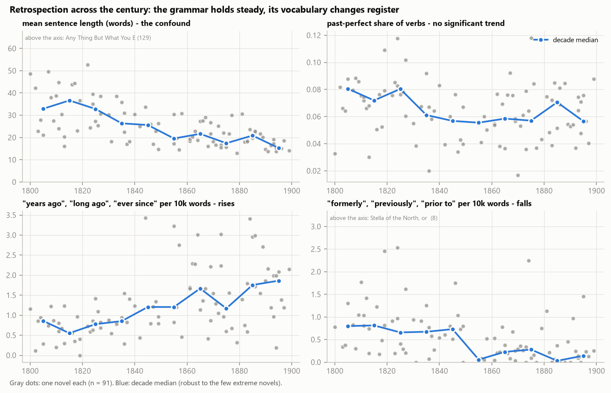

### 3. "Suddenly": the century's grammar of abruptness

"Suddenly" is the most frequent temporal marker in the corpus: 3,075
occurrences, more than three times the next phrase ("meanwhile", 816). It
rises across the century (ρ = +0.45, and +0.39 with sentence length
controlled, p = 0.0001, robust). It is flat at about 2 per 10k words until
the 1870s, then jumps to 4.1 in the 1880s and 3.5 in the 1890s.

The novels that lean on it hardest are not a random sample:

| Novel | "suddenly" / "all at once" per 10k words |
|---|---|
| *A Phantom Lover* (Vernon Lee, 1886) | 15.8 |
| *The Island of Doctor Moreau* (Wells, 1896) | 11.8 |
| *Wagner, the Wehr-Wolf* (Reynolds, 1846) | 8.9 |
| *Red Pottage* (Cholmondeley, 1899) | 7.3 |
| *Old Kensington* (Ritchie, 1873) | 6.4 |

They are a ghost story, a scientific romance, and a penny-dreadful
werewolf tale, plus two social novels. The fin-de-siècle jump coincides
with the late-century revival of romance and the gothic. "Suddenly" marks
an event that breaks into continuous time rather than a skip across it, so
this is a change in how narrative time *ruptures*, not in how it moves.
It's worth reading closely in the supernatural fiction specifically.

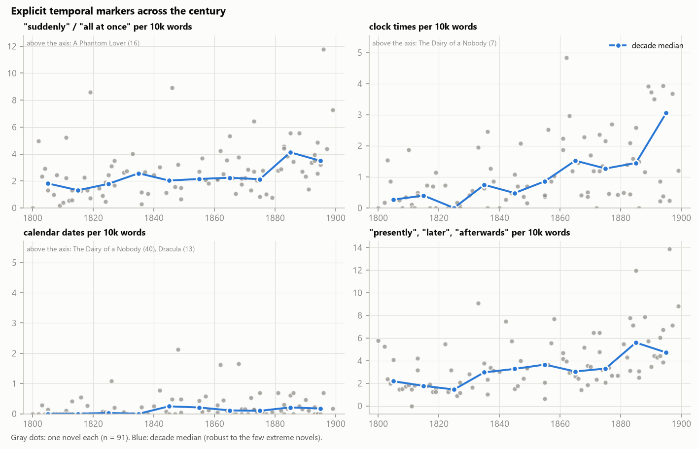

### 4. Clock time enters the novel (suggestive)

Clock times ("eight o'clock", "9:30", "half-past nine") rise more steeply
than any other marker: decade medians go from under 0.5 per 10k words
before 1830 to 3.1 in the 1890s (ρ = +0.48). With sentence length
controlled the trend is weaker (partial ρ = +0.25, p = 0.016) and doesn't
survive Bonferroni correction, so it's reported as suggestive. The novels
that lead are telling:

| Novel | Clock times per 10k words |
|---|---|
| *The Diary of a Nobody* (Grossmith & Grossmith, 1892) | 6.9 |
| *Lady Audley's Secret* (Braddon, 1862) | 4.8 |
| *The Prisoner of Zenda* (Hope, 1894) | 3.9 |
| *Three Men in a Boat* (Jerome, 1889) | 3.9 |
| *The Sign of the Four* (Doyle, 1890) | 3.7 |

The leaders are a sensation novel, a detective novel, and two comic
chronicles of suburban and holiday routine. The century's standardization
of time, with railway time spreading through the 1840s and Greenwich Mean
Time becoming Britain's legal time in 1880, is the obvious context, and
these novels are where a close reading of plotting by the clock would
start.

### 5. The engine recognizes literary form without being told

Several of the strongest signals in the data are literary forms, found by
a heuristic that has no notion of genre:

- **Diary and letter novels.** Calendar-date advances, counted only to
  improve the scene-duration estimate, rank the corpus's diary and
  epistolary novels at the top. *The Diary of a Nobody* has 160 date
  advances (and 40 dates per 10k words), *Dracula* 130, *The Tenant of
  Wildfell Hall* (Helen's diary) 24, and *The Moonstone* (dated narratives)
  13.
- **A present-tense novel.** The highest present-tense share in the corpus
  belongs to Rhoda Broughton's *Red as a Rose is She* (1870), at 51% of
  sentences against a corpus median around 15%. Reading the text confirms
  it: "Mrs. Brandon takes off and lays down her spectacles the better to
  point the rebuke she is about to administer." The narration really is in
  the present tense, an unusual choice for a Victorian novel that the
  engine singled out on its own.
- **A chapter where time stops.** All four clock times in *Alice's
  Adventures in Wonderland* fall at about 55% of the way through: the Mad
  Tea-Party, where the Hatter explains how you could "whisper a hint to
  Time, and round goes the clock" and complains that "it's always six
  o'clock now." The one stretch of the book that takes time as its subject
  is the one place clock time appears.

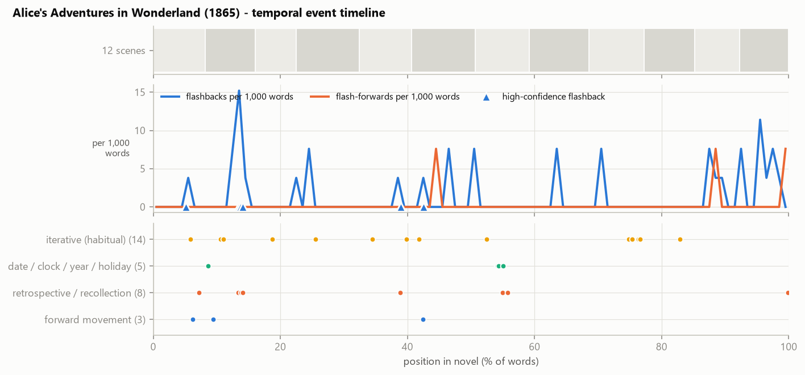

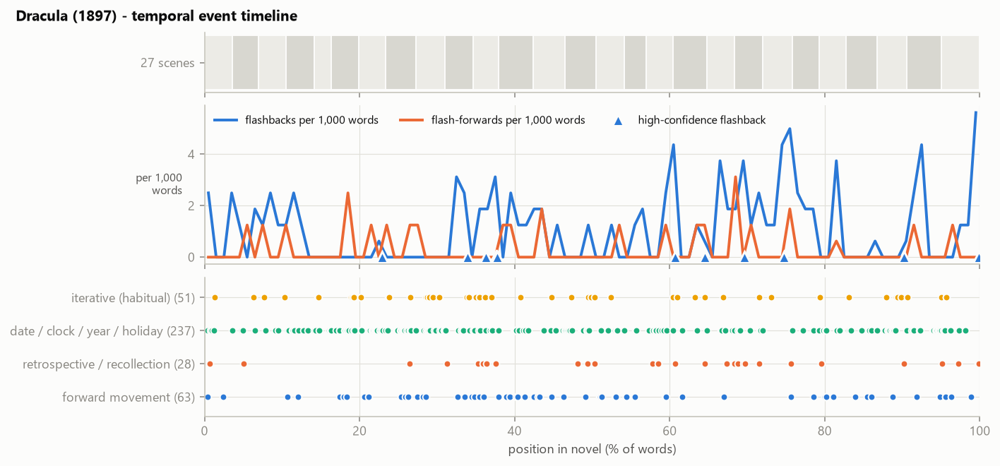

These are validations as much as findings. They show the measurements
track real features of the texts, which is what licenses reading the
corpus-level trends above as evidence rather than noise.

### 6. Author gender: an honest null result

The corpus is balanced by design (the 91 eligible novels are 47 by women
and 44 by men), so it can answer whether women and men novelists handle
narrative time differently. On these measures, **no difference survives
correction for multiple comparisons**. Women's novels lean slightly more
retrospective (past-perfect share of verbs, median 6.9% vs. 5.6%, p =
0.045) and more prospective (3.1% vs. 2.6%, p = 0.009), and men's novels
use more calendar dates (p = 0.006, driven by a few diary and epistolary
books). None of these clears the corrected threshold. They're leads for
close reading, not results. A null result here is useful in itself:
whatever distinguishes these novels by author gender isn't visible at the
level of tense and temporal marking.

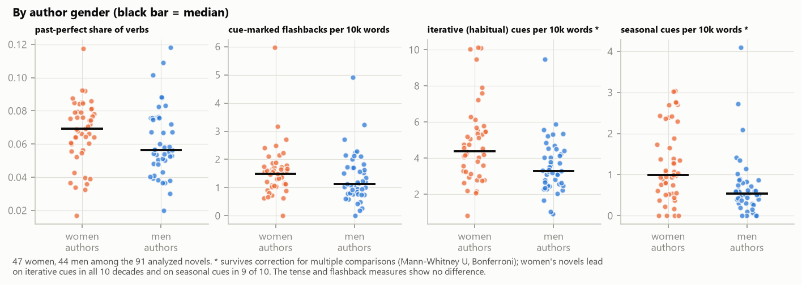

### 7. The flash-forward signal measures prospection, not prolepsis

Reading the flash-forwards closely changed how they should be named. In
Trollope's *The Way We Live Now*, the corpus leader at 10.3 per 10k words,
most are not the narrator jumping ahead:

> "He had a home to offer her, and is an honest man with whom she would
> have been safe and respected and happy." *(a conditional)*
>
> "Now she saw nothing before her but a long vista of Caversham dullness,
> in which she would be trampled upon by her father and mother..." *(a
> character's anticipation, in free indirect discourse)*

"Would" + verb captures conditionals, habits, and characters'
anticipations as well as true prolepsis. So the signal measures
**prospective consciousness**: how much a novel's characters imagine,
plan, and dread. That makes it a meaningful measure of Trollope's
free indirect style rather than an error, but it isn't Genette's
prolepsis. True narratorial prolepsis appears in the small cue-marked tier
(76 of 4,519), for example *Lady Audley's Secret*: "If any one could at
that moment have told the young barrister that so simple a thing as his
cousin's brief letter would one day come to be a link in [the chain]...",
the sensation novel's characteristic foreshadowing. The methodology
document should present the two as different things.

### 8. Methodological findings

- **The 2-of-3 flashback threshold holds at corpus scale.** One signal
  flags 15.0% of all 571,878 sentences, two signals 5.4%, and all three
  0.1%. These closely match the 5-novel figures that set the threshold
  (12.7%, 4.1%, 0.04%).
- **"From then on" never occurs** in the 91 novels. The other 24 marker
  phrases all appear; "suddenly" alone is a third of all marker hits.
- **Paragraph structure is lost in 27 of 91 source files** (see "Why a
  10-sentence passage"). This matters for anyone using HUM19UK for
  paragraph-level work.
- **Asterisk breaks** mark scenes in 29 of the 91 eligible novels (214
  breaks). Everywhere else the chapter is the finest structural scene
  unit available without human reading. That's the SOW's own caveat about
  scene detection, quantified.

## Limitations to carry into the methodology document

- **Heuristic detections, not ground truth.** No sample has been
  hand-annotated yet, so precision and recall are unknown. A small
  hand-checked sample per detector would be the strongest addition in
  Phase 4.
- **Flashbacks at confidence 0.6** mix real backstory with ordinary
  past-perfect subordinate clauses (Weeks 5-6). Treat them as a density,
  and confidence ≥ 0.8 as discrete events.
- **"Would" is ambiguous** between future-in-past, conditional, and habit
  (Finding 7).
- **Literal cues are polysemous.** "Recalled" also means "brought back"
  ("This spectacle recalled me to the reality of things").
- **Calendar dates carry no year**, so a date moving backwards may be a
  look back or a new year.
- **Scene is coarse in most novels**, because asterisk breaks appear in
  only 29 of 91.
- **The trend tests are exploratory**: one test per measure, corrected for
  multiplicity, on 91 novels chosen for balance, not sampled at random.

## Open items / needs supervisor input

Carried forward:

- **Multi-volume novel treatment.** The 9 single-volume novels stay
  excluded (`analysis_eligible = 0`). They can be analyzed with
  `--include-partial` if Shawna prefers include-with-caveat.
- **How flashbacks are drawn for readers**: ≥ 0.8 as discrete events and
  0.6 as a density curve, as the figures here already do. Worth
  confirming before the Phase 3 dashboard fixes the encoding.
- **Bracket-wrapped apparatus text cleanup**: still open. It touches only
  prefaces and notes, not the measures above.

New this period:

- **Which findings to pursue in Phase 4.** The SOW's Phase 4 analyzes 5-10
  representative novels in depth. The findings above suggest candidates
  that would test them: *Barry Lyndon* and *Wives and Daughters*
  (signposted retrospection), *A Phantom Lover* and *The Island of Doctor
  Moreau* ("suddenly"), *Lady Audley's Secret* (clock time and
  prolepsis), *Red as a Rose is She* (present tense), and *Wuthering
  Heights* (frame narration at every scale).
- **Naming the flash-forward signal.** Report it as "prospection" with a
  note on prolepsis, or keep the SOW's term?
- **Supplemental corpus (January 2027).** The SOW adds 10-20 novels from
  the 18th century, the modernists, and America, which will extend these
  century trends past both ends. Those Gutenberg texts won't carry
  HUM19UK's bracket headers. The pipeline's plain-text fallbacks exist for
  that case, but they'll need a calibration pass with `inspect_corpus.py`
  when the files arrive.

## How to reproduce

```bash
python -m src.analyze_temporal               # all 91 eligible novels (~1 h 50 min)
python -m src.verify_phase2 --require-full   # acceptance check
python -m src.analyze_temporal_corpus        # reports/data/temporal_*
python -m src.plot_phase2                    # reports/figures/phase2/
```

Interactive versions of the 5 test-novel figures (hover, zoom, pan) are in
`reports/figures/phase2/interactive/`.

## Next steps (Phase 3, Weeks 8-12)

- **Interactive dashboard** (Plotly Dash): select a novel, see its
  visualizations, zoom and pan, export. The interactive pages from this
  period are the starting point.
- **The SOW's three views**: a timeline (scenes, durations, labeled
  events), a pace/density plot (from `granularity_units`, which already
  holds every signal at every scale), and a flashback map (≥ 0.8 events
  over the 0.6 density, per the encoding question above).
- **Publication-quality export** (SVG/PDF) for 5+ novels.
- **Comparative view** (SOW optional): the century-trend figures here are
  a first version.
