# Weeks 9-10 — A supervisor's taxonomy meets the corpus, the paragraph is put to the test, and Phase 3's dashboard begins

**Period:** Weeks 9-10 (2026-10-27 to 2026-11-09); report filed 2026-11-10
**SOW phase:** Phase 2 — Temporal Analysis Engine (Weeks 4-9) — closed on schedule, its vocabulary, corpus, and middle scale revised; Phase 3 — Visualization Suite (Weeks 8-12) — **about 30% complete** (dashboard, timeline view, publication export)

## Summary

This period had three strands.

**1. A supervisor's taxonomy meets the corpus.** Dr. Ross contributed a
supplemental taxonomy of temporal cues, built from the narrative-time
schema she drafted over the summer after Genette and Rimmon-Kenan: 186
rows of 19th-century forward cues, frequency multipliers, seasons, and
holidays. It came with two methodological recommendations (don't let the
system default every scene to "continuous"; let iterative cues tell the
duration estimator that a span is unknown but longer than one occasion)
and two rulings on open items (exclude the single-volume texts; remove the
scholarly apparatus). All four are now in the engine:

- **The taxonomy is the engine's vocabulary**, a controlled vocabulary
  (`src/temporal/cue_taxonomy.csv`) that Dr. Ross can edit herself. Each
  row was tested against the 91 novels first, which surfaced period
  spellings ("Lady-day", not "Lady Day"), false friends ("Yule" is a surname
  in *New Grub Street*, "advent" always means arrival), and example phrases
  that never occur and had to be generalized into patterns.
- **No scene is continuous by default.** The old rule labelled 80% of
  scenes "continuous" for lacking a jump phrase. With evidence required,
  52% jump, **24% are iterative**, 9% are anchored, 9% continuous, and 6%
  carry no temporal cue.
- **Iterative events are marked**: 7,522 events carry the new
  `duration_modifier = 'multi-unit'`.
- **The apparatus is gone and the fiction stayed.** 640 bracketed spans
  (about 48,000 words) were removed, holding 174 temporal cues that the
  engine had been reading as story time. All 659 spans were read first,
  and 18 that belong to the fiction (the Sibyl's-leaves frame of *The Last
  Man*, Pooter's introduction, Quatermain's preface) were kept.

Re-run on the rebuilt corpus, the richer vocabulary revised two findings
and produced a new one. The Weeks 7-8 claim that retrospection's
signposting grows across the century is withdrawn: what changes is its
**register**, from "formerly" and "recollected" to "years ago" and "long
ago". And novels by women carry more **iterative** and **seasonal** cues,
the project's first gender difference to survive correction.

**2. The paragraph put to the test.** Weeks 7-8 used a fixed 10-sentence
passage as the middle scale because paragraph breaks survive in only 64 of
the 91 novels. This period built the alternative, the author's own
paragraphs as a fifth engine scale, and ran it on those 64:

- **At corpus scale the conclusions hold** (66% of flashbacks visible at
  paragraph scale against 61% at passage scale; the scene-scale washout is
  untouched), but **event by event the two scales often disagree**
  (Cohen's κ = 0.37).
- **Weeks 7-8 was wrong about paragraph size.** The median paragraph here
  is **37 words**, not about 190.
- **Restricting to the 64 biases the corpus** toward the first half of the
  century and drops four of this period's robust findings below
  significance. The passage stays; the paragraph stays too, as a literary
  unit measured where it survives.
- **Flashbacks don't open paragraphs.** Matched for paragraph length,
  they are slightly less likely than chance to be a paragraph's first
  sentence: retrospection enters mid-paragraph.

**3. Phase 3 begins.** An interactive dashboard (Plotly Dash) now does
what the SOW asks, "select a novel → see visualizations → zoom/pan →
export", for any of the 91 novels. Its first view is the SOW's
**timeline**: scenes as bars as long as their telling, coloured by the new
duration labels, with the story time their cues state and labelled events.
Every view exports to SVG, PDF, and PNG at publication size. The timeline
earned its keep at once: it shows Lady Audley's confession as a block of
retrospection and stated years, and it exposed a double count in the story
time of Dracula's overlapping diaries.

## Timeline

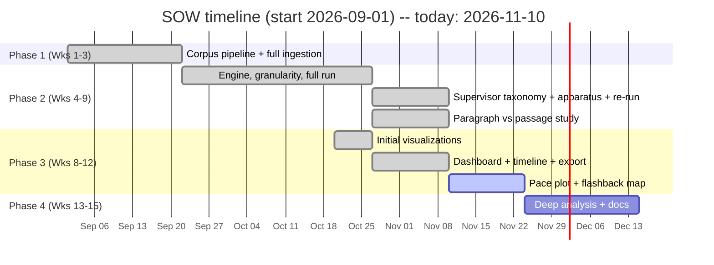

Phase 2's window closes in week 9. The taxonomy, the corpus rebuild, and
the paragraph scale are Phase 2 components, and Dr. Ross's input arrived
while they were still open to revision. Phase 3 (weeks 8-12) is on
schedule: the dashboard, the export path, and the first of three views are
done at the end of week 10, leaving the pace/density plot and the
flashback map for weeks 11-12.

## Architecture & Code

### Repository structure and commit history

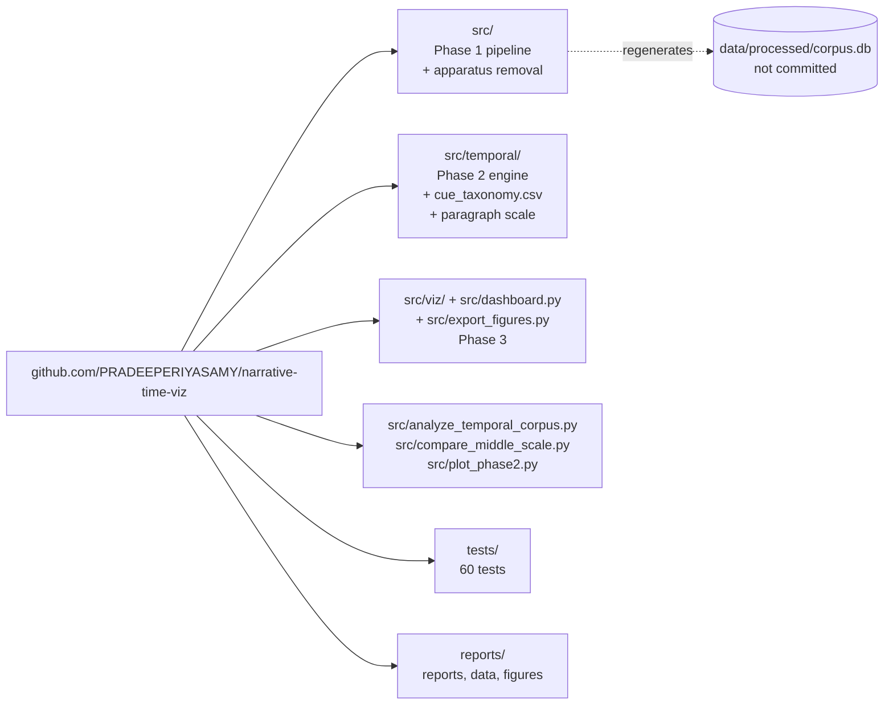

The Weeks 7-8 engine was still uncommitted when this period's first
changes began, and both landed together on 2026-10-28 as commits 27-35.
The Weeks 7-8 report's commit table names that period's work as planned;
this is how it was actually committed, followed by the rest of this
period's work:

| # | Commit | What it added |
|---|---|---|
| 27 | `0d80781 fix: remove scholarly apparatus, keep fictional frames, fix offset drift` | `src/config.py`, `src/preprocess.py`, `tests/test_preprocess.py` |
| 28 | `7db6ed9 feat: Ross cue taxonomy, absolute time references, evidence-based scene duration` | `src/temporal/temporal_markers.py`, `cue_taxonomy.csv`, `scene_duration.py`, `flashback_detector.py`, `tense_tagger.py` |
| 29 | `4bcc900 feat: granularity comparison schema and duration_modifier field` | `src/temporal/granularity.py`, `src/db.py`, `src/temporal/event_log.py` |
| 30 | `4030ebf feat: run taxonomy and granularity comparison in the temporal engine` | `src/analyze_temporal.py`, `src/verify_phase2.py` |
| 31 | `d883ab6 test: taxonomy, time references, scene labels, granularity comparison` | `tests/test_temporal.py` |
| 32 | `ee02890 feat: corpus-level temporal analysis with taxonomy trend family` | `src/analyze_temporal_corpus.py`, `requirements.txt`, `reports/data/` |
| 33 | `5e8f9fc feat: Phase 2 visualizations incl. scene duration labels` | `src/plot_phase2.py`, `reports/figures/` |
| 34 | `5305f71 docs: biweekly progress report for Weeks 7-8` | `reports/weeks-07-08.md` |
| 35 | `6a7001b docs: update README for taxonomy and apparatus removal` | `README.md` |
| 36 | `docs: regenerate Weeks 7-8 report figures from its own run` | `reports/weeks-07-08.md`, `reports/figures/weeks-07-08/` |
| 37 | `feat: paragraph level schema, migration, and event_id index` | `src/db.py` |
| 38 | `feat: the author's paragraph as a granularity level` | `src/temporal/granularity.py`, `src/analyze_temporal.py`, `src/verify_phase2.py`, `tests/test_temporal.py` |
| 39 | `feat: Phase 3 visualization layer and timeline view` | `src/viz/`, `tests/test_viz.py` |
| 40 | `feat: Phase 3 dashboard and publication export` | `src/dashboard.py`, `src/export_figures.py`, `requirements.txt`, `reports/figures/phase3/` |
| 41 | `feat: paragraph-vs-passage comparison of the middle scale` | `src/compare_middle_scale.py`, `reports/data/middle_scale_*` |
| 42 | `docs: biweekly progress report for Weeks 9-10` | `reports/weeks-09-10.md`, `reports/figures/weeks-09-10/` |
| 43 | `docs: update README for Phase 3 and the paragraph scale` | `README.md` |

Commit 36 restores the Weeks 7-8 report's figures. This period's re-run
regenerated `reports/figures/phase2/`, so that report's "signposting
grows" text sat beside a figure that by then said the opposite. Its nine
figures were regenerated from that period's database snapshot, and each
report now keeps its own figure folder.

### From supervisor's schema to engine vocabulary

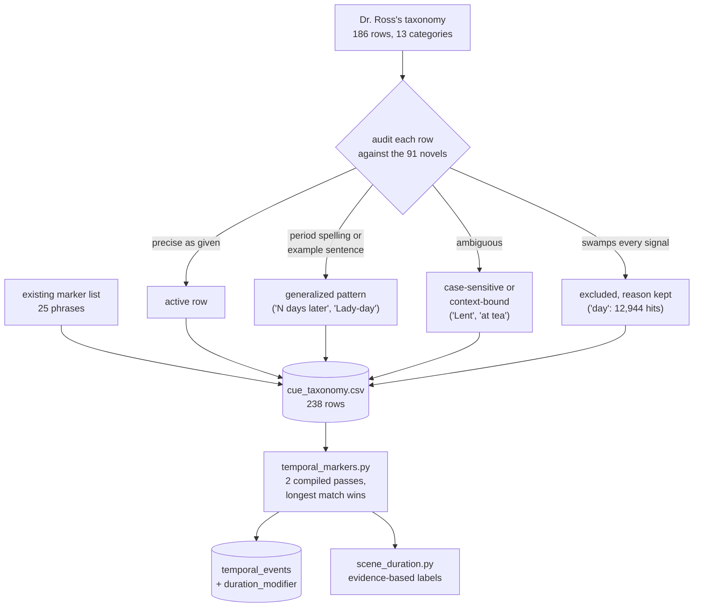

`cue_taxonomy.csv` keeps every row, including the ones not matched, with
its status and the reason:

| Status | Rows | Meaning |
|---|---|---|
| active | 170 | matched by the engine |
| covered | 55 | a broader pattern matches it (e.g. "for three days" → "for N units") |
| excluded | 13 | not matched, with the evidence in `notes` (e.g. "fall": 1,554 hits, almost all the verb) |

| Source | Rows |
|---|---|
| Ross taxonomy (Oct 2026) | 171 (her other 15 rows were already in the list) |
| Corpus audit (period variants, generalized patterns) | 42 |
| Phase 1 list | 13 |
| Weeks 3-4 additions | 12 |

The matcher compiles all literal phrases into one alternation (longest
first) and all patterns into another, then resolves overlaps so the longer
cue wins ("two years later" over "years later"). Patterns read their
quantity, so "two years later" records +730 days and "for three long
weeks" +21. The file is plain CSV: Dr. Ross can add a row, change a
confidence, or switch a row off, and `pytest` checks every row before the
next run.

### The tiered schema

Dr. Ross asked for "a tiered temporal cue schema" rather than a flat list.
Every category now belongs to one tier, which says what kind of claim a
cue makes about story time:

| Tier | Categories | What a cue claims | Matches in the corpus |
|---|---|---|---|
| absolute | calendar date, clock time, year, holiday | a fixed point on the calendar or clock | 3,007 |
| movement | forward jump, retrospective, recollection, duration, biographical, travel | story time moves, or a span is stated | 10,717 |
| position | time of day, meal, season, simultaneity, anchor | a place within a day or year, no movement | 18,544 |
| order | sequence ("presently", "afterwards") | succession, no gap stated | 4,744 |
| iterative | frequency ("used to", "every Sunday") | repeated events; span unknown, > 1 occasion | 5,433 |
| not temporal | abruptness ("suddenly") | an event breaking into continuous time | 3,291 |

Explicit-marker sentences rose from 8,925 to **40,497**, and every one now
records its tiers, its strongest cue's confidence (from the taxonomy), and
any stated quantity.

### Scene duration: from a default to evidence (`scene_duration.py`)

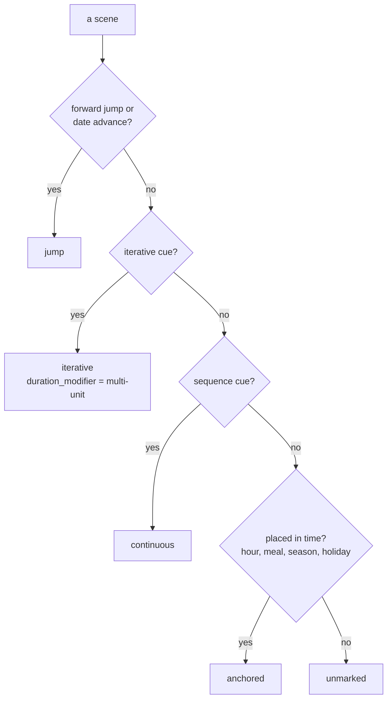

The Weeks 7-8 estimator had two labels: "spans N jumps" or "continuous".
"Continuous" was the default for any scene without a jump phrase, exactly
the presumption Dr. Ross warned against. "Continuous" now needs positive
evidence (sequence cues with no gap), and a scene with no temporal cue at
all is "unmarked": the text says nothing either way. Where cues state
quantities, the scene also records the story time they add up to (median
2 days across the 1,746 scenes that state one).

### Removing the apparatus without removing the fiction (`preprocess.py`)

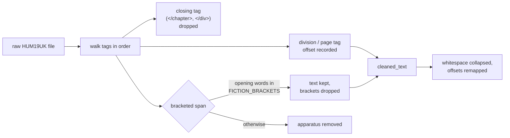

The corpus compilers wrapped everything that isn't narrative in bare
brackets. Before trusting a rule, every one of the 659 bracketed spans in
the 91 novels was read. The rule removes 640 of them: title pages,
imprints, dedications, prefaces, contents lists, footnotes, glossaries,
illustration captions, transcribers' notes, and "END OF VOL." lines, about
48,000 words in 84 novels. The text now runs 570,123 sentences and 12.37
million words, against 571,878 and 12.42 million before; page markers
(1,761) and divisions (3,694) are unchanged in every novel.

The same brackets also hold fiction. These keep their text:

| Novel | Bracketed passage kept | Why it's fiction |
|---|---|---|
| *The Last Man* (Shelley, 1826) | "I visited Naples in the year 1818..." | the frame: the narrator finds the Sibyl's leaves |
| *King Solomon's Mines* (Haggard, 1885) | "Now that this book is printed..." | Quatermain's preface, signed "A.Q." |
| *The Diary of a Nobody* (Grossmith, 1892) | "Introduction by Mr. Pooter" | Pooter introducing his own diary |
| *The Heavenly Twins* (Grand, 1893) | the Proem | the novel's opening |
| *John Inglesant* (Shorthouse, 1881) | the "Introductory Chapter" and notes | the fictional editor of the manuscript |
| *The Antiquary* (Scott, 1816) | Oldbuck's asides as he reads a letter aloud | spoken in the scene |
| *The Heroine* (Barrett, 1813) | "The Heroine to the Reader" | Cherry Wilkinson, in character |
| *The Nemesis of Faith* (Froude, 1849) | "These fragments require no comment..." | the fictional editor |
| *Joshua Davidson* (Linton, 1872) | the preface | the narrator, "his nearest friend" |

Three cases sit on the line and are listed under Open items.

Reading the spans also exposed a Phase 1 bug. Whitespace was collapsed
*after* division and page offsets were recorded, so every offset drifted by
the whitespace removed before it: in the old database, Dracula's last
chapters "began" at "er, Evening." The collapse now returns an offset map,
and every division lands on its chapter's first word ("11 October,
Evening.-Jonathan Harker has asked me...").

### The paragraph scale (`granularity.py`)

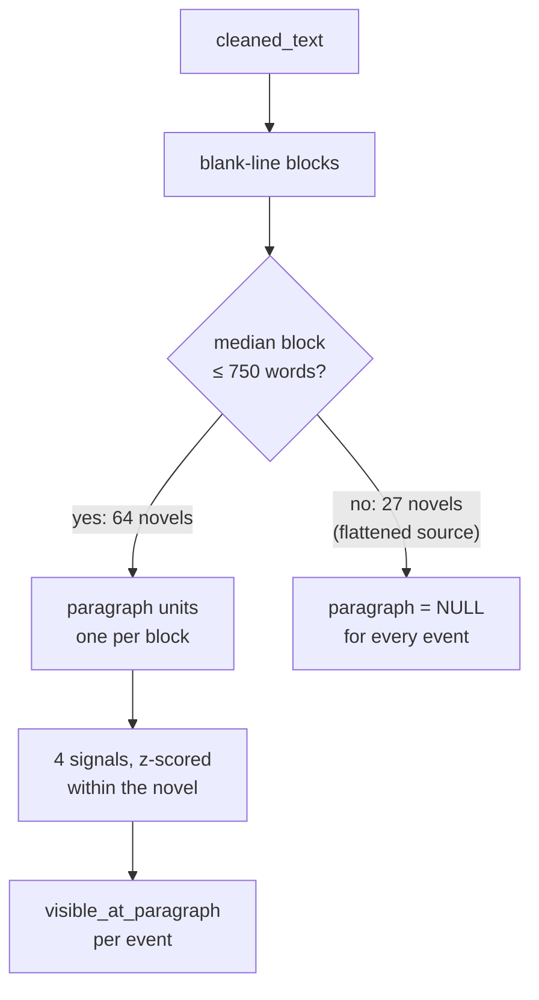

The paragraph is now a fifth level in `granularity_units` and
`granularity_comparison`, between word and passage. It exists only where
the source kept paragraphs; elsewhere it is NULL, the convention the page
level already uses. The threshold of 750 words reproduces the 64 novels
the Weeks 7-8 report counted. A stricter threshold (median ≤ 200 words)
gives 56: the other 8 have blocks of 300-750 words, which are diary
entries or sections rather than paragraphs (*Dracula*, *King Solomon's
Mines*, *The Vampyre*, *The Nemesis of Faith*, and four Chawton House
texts). The comparison reports both.

| Novels | Median block | Middle scale available |
|---|---|---|
| 56 strict | ≤ 200 words | paragraph and passage |
| 8 long-block | 300-750 words | paragraph (entry or section length) and passage |
| 27 flattened | 950-5,600 words | passage only |

### Phase 3 architecture

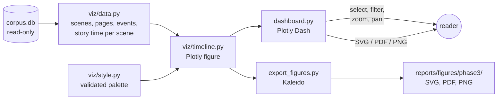

The views read the database **read-only**, so the dashboard can run while
the engine is writing, and nothing in Phase 3 can alter an analysis
result. Every view is a pure function from one novel's data to a Plotly
figure, so the dashboard and the batch exporter draw exactly the same
thing. The palette module is shared with the Phase 2 figures, so a scene
label has one colour across the reports, the dashboard, and the exports.

### The dashboard

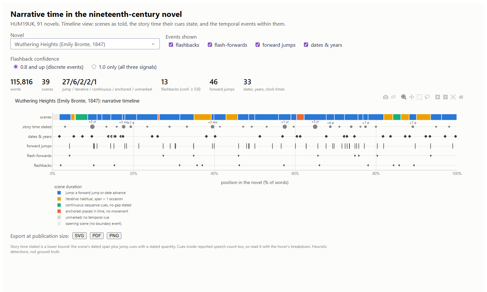

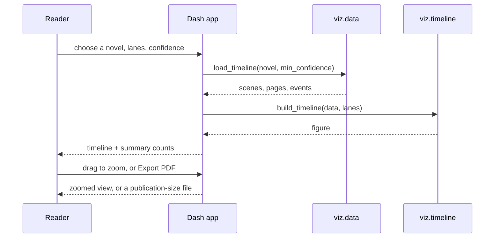

`python -m src.dashboard` serves it locally. A reader picks any of the 91
novels (listed by title, author, and year), chooses which event lanes to
show and whether flashbacks need 0.8 or 1.0 confidence, and gets the
timeline with a strip of counts: words, scenes, the scene-label mix,
flashbacks, jumps, and absolute time references. Drag to zoom,
double-click to reset, hover for any scene's chapter and counts or any
event's sentence. The export buttons render the current view at 1400 × 460
pixels as SVG, PDF, or PNG; the camera icon saves an SVG directly from the
browser.

### The timeline view (`viz/timeline.py`)

The SOW asks for "a horizontal bar chart showing narrative progression —
scene boundaries, durations, labeled events (flashbacks, temporal jumps)".
The design puts the two kinds of duration Genette distinguishes, the
length of the telling and the time told, one above the other:

| Lane | Shows | Encoding |
|---|---|---|
| scenes | each scene, as long as its telling | bar width = share of the novel's words; colour = duration label |
| story time stated | the story time the scene's cues state | dot at the scene's middle, area ∝ log(days); label ("+3 mo") when it can be read |
| dates & years | calendar dates, clock times, years, holidays | diamond |
| forward jumps | "the next morning", "two years later" | tick |
| flash-forwards | prospective passages at the chosen confidence | right-pointing triangle |
| flashbacks | retrospective passages at the chosen confidence | left-pointing triangle |

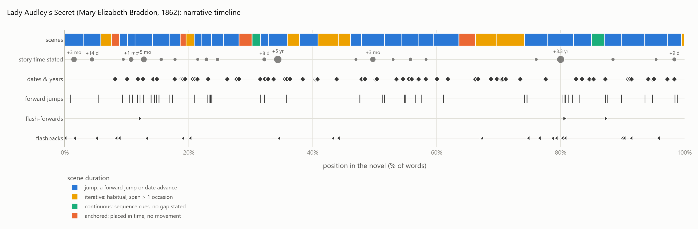

Event marks are neutral ink: identity comes from the lane, so the scene
colours keep a single meaning. Story-time labels are selective (every
value when a novel has 20 scenes or fewer, otherwise only a week or more),
and the hover always has the number and how it was reached.

### Reading story time per scene: the dated span

The engine records each scene's stated story time as a running sum of
date advances plus quantified jump cues. Drawing it showed the flaw. In a
novel of several diarists, dates don't advance along one line:

| Dracula, scene 5 | Dates in order | Running sum | Dated span |
|---|---|---|---|
| Mina's journal, then Seward's diary | 24 Jul, 1 Aug ... then 5 Jun, 18 Jun ... 6 Aug | 494 days | 62 days (5 Jun - 6 Aug) |

Mina's entries run 24 July to 1 August, then Seward's diary starts again
at 5 June, and the running sum counts the overlap twice. The timeline
therefore reads a scene's story time as its **dated span** (earliest to
latest date in it) plus its quantified jump cues, and the hover shows the
breakdown with the running sum beside it. Across Dracula the scene-by-scene
total drops from 930 days to 731.

The remaining 365 of scene 5's total is the second lesson: it comes from
"a year later" on a tombstone Mr Swales reads aloud. Cues inside reported
speech and inscriptions count as story time, so the stated time is a lower
bound in principle and an overestimate wherever characters talk about
other times. The hover makes that visible rather than hiding it.

### Database additions

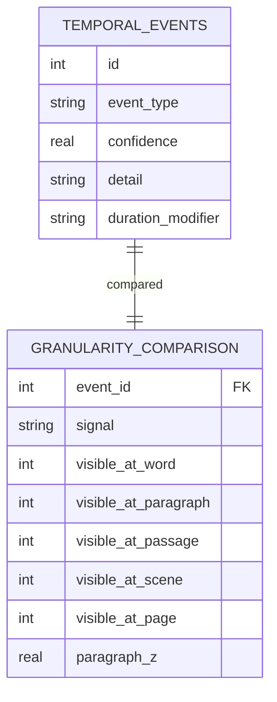

- `temporal_events.duration_modifier` is the field Dr. Ross proposed:
  `'multi-unit'` when an event's story-time span is unknown but likely more
  than one occasion. It is set on 7,522 events: every explicit-marker
  sentence with an iterative cue, and every scene containing one.
- `granularity_comparison` gains `visible_at_paragraph` and
  `paragraph_z`, and `granularity_units` accepts the `'paragraph'` level.
  SQLite can't alter a CHECK constraint, so an older database has that
  table rebuilt under the new schema with every row copied (557,370 rows in
  7 seconds).

All three changes migrate an existing database in place.

The paragraph re-run also uncovered a latent performance bug. Re-analyzing
a novel deletes its old events, and with foreign keys on, SQLite checks
each deleted event against `granularity_comparison.event_id`, which had no
index, so a re-run scanned the whole 344,000-row table once per event.
Every earlier run started from empty tables and never hit it; the test
slice took over ten minutes instead of one. An index on `event_id` brought
it back to 91 seconds.

### Test coverage

20 new tests this period (one replaced), 60 in the suite overall (9 Phase
1, 46 Phase 2, 5 Phase 3), all passing:

| Test | Verifies |
|---|---|
| `test_apparatus_and_closing_tags_removed` | prefaces, footnotes, "END OF VOL.", closing tags gone; offsets still land on the narrative |
| `test_fiction_bracket_keeps_its_text` | a listed fictional frame keeps its words, even across a line break |
| `test_taxonomy_rows_are_well_formed` | every CSV row has a known category, a valid confidence, and a reason if not active |
| `test_sequence_words_are_not_jumps` | "presently", "afterwards", "later" are sequence, not forward jumps |
| `test_period_forward_jumps` | "on the morrow", "ere long", "next day" |
| `test_ambiguous_holiday_words_need_their_holiday_sense` | "lent", "advent", "Mr Yule" are not holidays; "Lent", "at Yule", "Lady-day" are |
| `test_bare_units_seasons_and_tea_need_context` | "a day", "the secret spring", "tea-board" no; "in the winter", "after tea" yes |
| `test_iterative_cues_carry_multi_unit` | habitual "used to" yes, "I was not used to walking" no |
| `test_quantities_become_days` | "a twelvemonth after" = 365, "for three long weeks" = 21 |
| `test_spelled_out_dates_and_years` | "the fifteenth of July", "July the fifth", "17--", "the year 1756" |
| `test_duration_label_needs_positive_evidence` | no cue = "unmarked", never "continuous" |
| `test_advance_days` | 3 May to 7 May = 4 days; 31 June is no date |
| `test_paragraph_blocks_locate_each_paragraph` | blank-line blocks found at their first word, with word counts |
| `test_flattened_source_has_no_paragraphs` | chapter-sized "paragraphs" (Wuthering Heights' source) don't count |
| `test_paragraph_level_is_null_where_paragraphs_are_lost` | NULL, not 0, where a novel has no paragraphs |
| `test_scenes_tile_the_novel_and_carry_labels` | scenes cover the novel; the opening scene has no boundary event |
| `test_story_time_is_dated_span_plus_quantified_jumps` | 3 May to 7 May plus "two days later" = 6 days, not the running sum |
| `test_low_confidence_flashbacks_are_not_discrete_events` | the confidence threshold filters flashbacks, not dates or jumps |
| `test_timeline_figure_has_a_trace_per_label_and_lane` | every label has a legend entry; lanes can be switched off |
| `test_format_days` | "+12 h", "+1 d", "+2 mo", "+1 yr" |

The Phase 3 tests build a two-scene novel in a temporary database with the
real schema, so they test the actual SQL without the corpus.

## What was done

- **Integrated Dr. Ross's taxonomy** as the engine's controlled
  vocabulary, after testing every row against the corpus (Findings #8).
- **Implemented her two recommendations**: the tiered schema with
  evidence-based scene labels, and the `duration_modifier` field.
- **Added the period's own absolute-time forms**: spelled-out dates and
  years, including the withheld "17--" (17 instances).
- **Removed the scholarly apparatus** and kept the fictional frames, after
  reading all 659 bracketed spans, and **fixed a Phase 1 offset drift**.
- **Added the author's paragraph as a fifth engine scale** and ran the
  paragraph-vs-passage study (`compare_middle_scale.py`).
- **Rebuilt the corpus and re-ran the engine** on all 91 novels.
  `verify.py` and `verify_phase2 --require-full` pass; the latter now also
  checks the new labels, the modifier, that no apparatus is left, and that
  the paragraph level exists exactly where paragraphs survive.
- **Re-ran the corpus analysis** with the taxonomy's categories as a
  second, separately corrected test family, and re-checked each Weeks 7-8
  finding against the new vocabulary.
- **Built the Phase 3 dashboard and timeline view**, with publication
  export, and exported timelines for the 5 test novels plus *Lady
  Audley's Secret* and *The Diary of a Nobody*.
- **Fixed the re-run slowdown** (a missing foreign-key index) and
  **restored the Weeks 7-8 report's figures** from its own run.
- **Wrote Dr. Ross a reply** with the audit results, the effect of each
  recommendation, and three borderline apparatus cases for her ruling.

## Decisions made

- **Dr. Ross's rulings applied.** The 9 single-volume texts stay excluded,
  and the apparatus is removed. Both were open items since Weeks 1-2.
- **The vocabulary lives in a CSV, not in code**, so the person with the
  narratological expertise can revise it directly, and every decision
  about a row is recorded with its evidence.
- **Audit before adopting.** No row went in on its own authority; several
  example phrases ("she was now ten years old") occur nowhere in the corpus
  and were generalized into patterns that do.
- **Sequence words are their own category**, so "presently" and
  "afterwards" don't repeat the "suddenly" problem of Weeks 5-6.
- **Bare units and day-parts need context** ("day" alone: 12,944 hits).
- **Apparatus out, fiction in, notes out**, notes removed even when
  written in a persona. Dr. Ross is asked to confirm.
- **The taxonomy's categories are a second test family** with their own
  Bonferroni threshold (12 tests, p < 0.0042), so findings already reported
  aren't held to a silently higher bar.
- **The passage stays the corpus-wide middle scale**, now on evidence
  (Findings #4-7); the paragraph is kept as a second middle scale where it
  survives. Two paragraph thresholds are reported: 750 words reproduces the
  64, 200 words isolates unmistakable paragraphs.
- **Plotly Dash for the dashboard**, as the SOW suggests; local, one
  command, no deployment (SOW section 8).
- **One axis, the novel's own length**, with discourse time and story time
  on separate lanes, and page numbers in the hover where reliable.
- **Dated span, not running sum**, for a scene's story time on the
  timeline, with the running sum kept in the hover.
- **High-confidence flashbacks as discrete events** (≥ 0.8 by default, 1.0
  as an option), as proposed in Weeks 7-8.
- **Each report keeps its own figures**, so a re-run can never change what
  an earlier report shows.

## Current state vs. SOW

| Duty | Status |
|---|---|
| Explicit temporal markers (Phase 2) | **Done and extended**: 170 active cues in 15 categories and 6 tiers, plus dates (numeric and spelled out), clock times, and years |
| Scene duration estimation (Phase 2) | **Done and revised**: evidence-based labels, an iterative modifier, stated story time |
| Multi-granularity analysis (Phase 2) | **Done and extended**: the author's paragraph as a fifth scale where it survives |
| Removal of front/back matter (Phase 1) | **Done**: the apparatus is removed and fictional frames kept, closing the Weeks 1-2 open item |
| Timeline view (Phase 3) | **Done**, for all 91 novels |
| Pace/density plot (Phase 3) | Next (Weeks 11-12): `granularity_units` already holds every signal at every scale |
| Flashback map (Phase 3) | Next (Weeks 11-12) |
| Comparative view (Phase 3, optional) | Not started |
| Interactive dashboard, export to SVG/PDF, simple UI (Phase 3) | **Done**: select → view → zoom/pan → export |

| Phase 3 deliverable | Status |
|---|---|
| Working visualization dashboard | **Done** for the timeline view |
| Publication-quality figures for 5+ novels | **In progress**: timelines for 7 novels as SVG/PDF/PNG |
| Screenshots and exports for teaching and research | **Started**: `reports/figures/phase3/` |

| SOW success criterion | Status |
|---|---|
| HUM19UK corpus preprocessed and stored | **Met**, now without apparatus |
| Engine detects at least 4 feature types | **Met** across all 91 eligible novels |
| Output structured and reproducible for any novel | **Met** |
| At least 3 visualization types implemented and working | 1 of 3 |
| Interactive dashboard can display visualizations for any novel | **Met** for the timeline (all 91 novels) |

Phase 3 is about **30% complete**: the dashboard, the export path, and
one of three views. Those are the parts every later view reuses, so the
remaining two views should go faster than the first.

## Findings

Numbers come from `reports/data/temporal_corpus_summary.json`,
`reports/data/temporal_novel_stats.csv`,
`reports/data/middle_scale_comparison.json`, and
`reports/data/middle_scale_by_novel.csv`. Correlations are Spearman's ρ
with publication year. "Robust" means the trend holds with sentence length
controlled and survives Bonferroni correction within its test family (p <
0.0033 for the Weeks 7-8 family, p < 0.0042 for the taxonomy family).

### 1. Most scenes are not "continuous": what the old default concealed

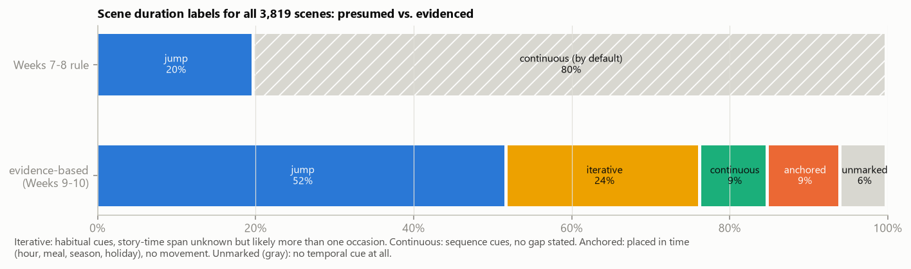

| Label | Scenes | Share |
|---|---|---|
| jump | 1,983 | 52% |
| iterative | 934 | 24% |
| anchored | 352 | 9% |
| continuous | 326 | 9% |
| unmarked | 224 | 6% |

Under the Weeks 7-8 rule, 3,060 of these 3,819 scenes (80%) were
"continuous". Once a label needs evidence, a quarter of all scenes turn
out to be **iterative**: they narrate what used to happen, what happened
every Sunday, what she would do of an evening. In Genette's terms this is
the iterative mode, a single telling of many occasions, and the old
default had been reading it as one unbroken stretch of time. Only 9% of
scenes show positive evidence of continuity, and they form a recognisable
group: *The Prisoner of Zenda* (38% of its scenes), *The Island of Doctor
Moreau* (36%), and *The Egoist* (34%), novels told as a close succession of
events. The most iterative are *Joshua Davidson* (58%), *Alice* (55%), and
*The Nemesis of Faith* (50%), built from habits, repetitions, and states of
mind rather than dated events. An iterative scene is as common as a
continuous and an anchored one put together.

### 2. Retrospection changes register, not volume (a correction to Weeks 7-8)

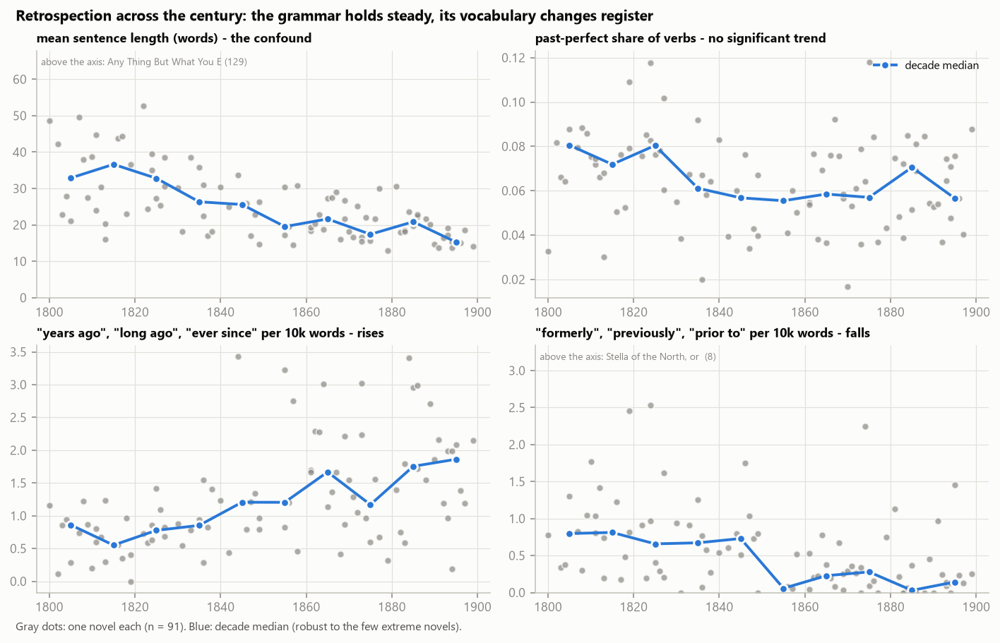

The Weeks 7-8 report found that while the grammar of retrospection holds
steady across the century, its signposting grows: retrospective phrases
rose robustly (partial ρ = +0.42), and so did cue-marked flashbacks (+0.34).
With the taxonomy's retrospective and recollective cues added, that no
longer holds:

| Measure | ρ with year | Sentence length controlled | Robust? |
|---|---|---|---|
| All retrospective cues per 10k words | +0.11 | +0.20 (p = 0.057) | no |
| Original phrases ("years ago", "long ago", "ever since") | +0.51 | +0.44 (p = 0.00002) | **yes, rise** |
| Ross's additions ("formerly", "previously", "prior to") | −0.50 | −0.34 (p = 0.001) | **yes, fall** |
| Cue-marked flashbacks per 10k words | −0.09 | +0.04 (p = 0.68) | no trend |

Phrase by phrase, the pattern is a change of register:

| Rising | ρ | Falling | ρ |
|---|---|---|---|
| "years ago" | +0.56 | "formerly" | −0.50 |
| "long ago" | +0.37 | "recollected" | −0.51 |
| "ever since" | +0.30 | "soon after" | −0.32 |
| "later" | +0.76 | "previously" | −0.25 |
| "presently" | +0.41 | "shortly after" | −0.21 |

Latinate, formal adverbs ("formerly", "previously", "recollected") give way
to phrasal, colloquial ones ("years ago", "long ago", "remembered"). The
Ross additions fall abruptly at mid-century: decade median 0.73 per 10k
words in the 1840s, 0.06 in the 1850s. The Weeks 7-8 list happened to
contain only the later-century idiom, so it saw a rise where there was a
substitution.

The cue-marked flashback trend fails for the same reason. In the 1800s,
**71% of strongly cued flashbacks** (155 of 217) are cued only by the words
the old list lacked; from the 1850s on, it's 7-22%. Early-century
retrospection was always signposted, in a vocabulary the engine couldn't
see.

So the Weeks 7-8 claim is withdrawn and replaced by a more interesting
one: **the lexicon of narrated time colloquializes across the century**.
This fits what corpus linguists have described as the drift of fictional
prose toward more oral, involved styles (Biber & Finegan 1989), here traced
in the specific vocabulary of time. It also shows how sensitive a lexical
measure of narrative time is to its word list, which is the strongest
argument for a vocabulary built by someone who knows the period.

### 3. Women's novels and iterative, seasonal time

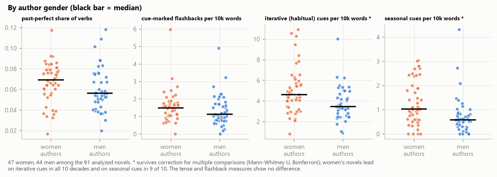

The Weeks 7-8 report found no gender difference in tense or retrospection,
and none appears there now. But two of the taxonomy's categories separate
the corpus's 47 women and 44 men, and both survive correction:

| Measure (per 10k words) | Women (median) | Men (median) | p | Decades where women lead |
|---|---|---|---|---|
| Iterative cues ("used to", "usually", "every day") | 4.63 | 3.45 | 0.0013 | 10 of 10 |
| Seasonal cues ("the summer", "the spring", "the winter") | 1.04 | 0.59 | 0.0009 | 9 of 10 |

Neither depends on one novel or one phrase. Women lead on "used to" (1.60
vs. 1.23), "usually" (0.63 vs. 0.38), and "every day" (0.56 vs. 0.43), and
on each season. The leaders on iterative cues are *Black Beauty* (Sewell,
10.9), *Old Kensington* (Ritchie, 10.6), and *Little Lord Fauntleroy*
(Burnett, 10.3), with Thackeray's *Barry Lyndon* (10.0) the exception. The
top novel for seasons is a man's, *Lorna Doone* (4.3), yet women's novels
still lead in nine decades of ten.

This is a measurement, and its interpretation belongs to close reading,
but the shape is suggestive: a narrative time of habit and recurrence, the
year's round rather than the dated event. It invites comparison with
accounts of cyclical, repetitive time as a dimension of women's experience
(Kristeva's "Women's Time") and with the domestic novel's investment in
routine. A detection of "every day" can't settle that; it does show the
difference is real at corpus scale and worth the reading. (Finding #6
shows it needs the full 91 novels to reach significance.)

### 4. The paragraph in these novels is not what Weeks 7-8 assumed

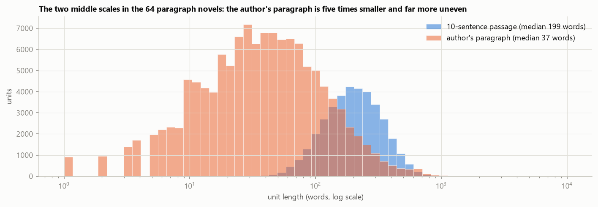

| In the 64 paragraph novels | Author's paragraph | 10-sentence passage |
|---|---|---|
| units | 125,654 | 37,035 |
| median length | **37 words** | 199 words |
| 10th-90th percentile | 8-148 words | 100-380 words |
| shorter than a 25-word bin | **36%** | 0.1% |
| variation within a novel (median CV) | 0.99 | 0.37 |

The Weeks 7-8 report justified the passage partly by saying its median
(192 words) was "close to a typical 19th-century paragraph". In this
corpus that isn't true. The median paragraph is 37 words, a passage holds
about five of them, and more than a third of all paragraphs are shorter
than the engine's finest bin. That is the shape of Victorian printed
prose: each speech in dialogue takes its own paragraph, beside long
paragraphs of narration. So the paragraph is not a middle scale in the way
the passage is. It is a scale of *variable* size that follows the
alternation of dialogue and narration: a different instrument rather than
a coarser or finer one.

### 5. Paragraph vs. passage: the conclusions hold, individual verdicts don't

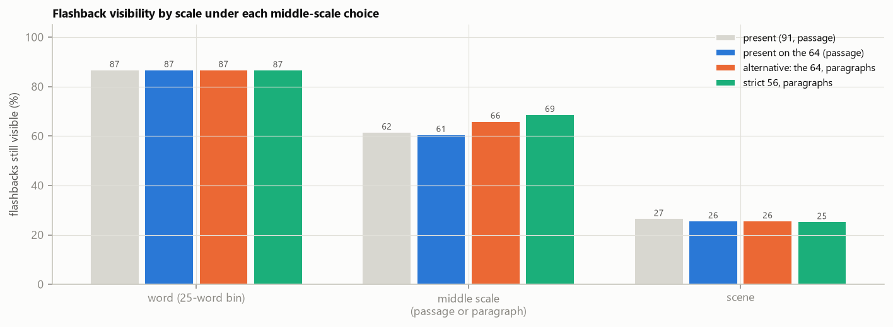

Visibility of the same flashbacks at each scale:

| Configuration | Novels | Word | Middle scale | Scene | Lost from word by the middle scale |
|---|---|---|---|---|---|
| present (passage) | 91 | 87% | 62% | 27% | 36% |
| present on the 64 (passage) | 64 | 87% | 61% | 26% | 37% |
| alternative (paragraph) | 64 | 87% | **66%** | 26% | **32%** |
| strict 56 (paragraph) | 56 | 87% | **69%** | 25% | 29% |

| Other signals | Passage (64) | Paragraph (64) |
|---|---|---|
| prospection (flash-forwards) | 79% | 75% |
| marker density (marker sentences) | 43% | 43% |
| tense churn (tense shifts) | 19% | 13% |

The project's headline result, that a scene-scale reading misses most of
the retrospection a sentence-scale reading sees (72% of word-visible
flashbacks), doesn't depend on the middle scale: scene is the same in every
configuration. The paragraph keeps a few more flashbacks visible than the
passage (66% against 61%), and more again where the paragraphs are
unmistakable (69%).

The contrast with tense churn is the interesting part. Short units are
noisier, and noise alone would raise visibility for every signal. It
doesn't: tense shifts are *less* visible at paragraph scale (13% against
19%), and markers are unchanged. Retrospection is the signal the paragraph
favours, which suggests Victorian paragraphing groups retrospective
sentences together: a paragraph tends to stay in the past once it has gone
there, while shifts of tense are spread across paragraph boundaries.

Event by event, though, the two scales often disagree:

| Flashbacks in the 64 | Visible at paragraph | Not visible at paragraph |
|---|---|---|
| **visible at passage** | 8,164 | 2,068 |
| **not visible at passage** | 2,938 | 3,813 |

They agree on 70.5% of flashbacks, but Cohen's κ is only 0.37 ("fair"
agreement once chance is allowed for), and the disagreement leans toward
the paragraph (McNemar p < 10⁻³³). High-confidence flashbacks agree slightly
better (κ = 0.40); markers (κ = 0.28) and tense shifts (κ = 0.24) agree
less well. Corpus-wide shares are stable under either choice, but any
claim about one flashback at the middle scale depends on which middle
scale was used. The methodology document should say so, and the flashback
map should state its scale.

Across novels the two scales rank similarly (Spearman ρ = 0.71), and the
difference follows paragraph length (ρ = −0.47, p = 0.0001):

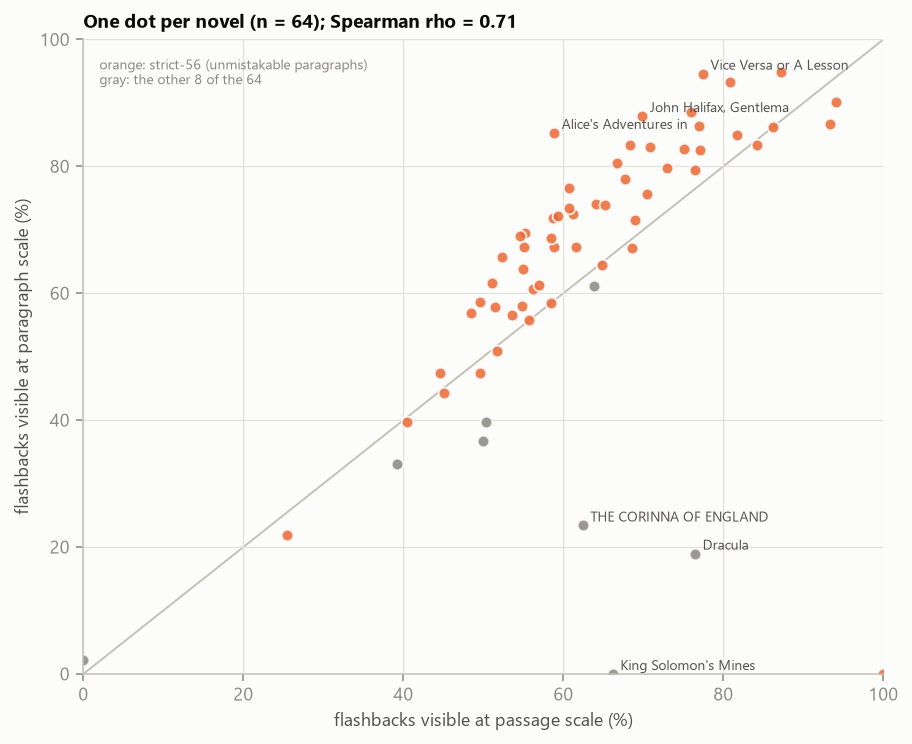

| Novel | Median paragraph | Flashbacks visible: passage | Paragraph |
|---|---|---|---|
| *Alice's Adventures in Wonderland* (Carroll, 1865) | 22 words | 59% | **85%** |
| *John Halifax, Gentleman* (Craik, 1857) | 23 words | 70% | **88%** |
| *Vice Versa* (Anstey, 1882) | 37 words | 77% | **95%** |
| *Sybil* (Disraeli, 1845) | 26 words | 61% | 77% |
| *The Antiquary* (Scott, 1816) | 39 words | 55% | 69% |
| *Dracula* (Stoker, 1897) | 409 words (entries) | 76% | **19%** |
| *King Solomon's Mines* (Haggard, 1885) | 739 words (sections) | 66% | **0%** |
| *The Corinna of England* (1809) | 610 words | 62% | 23% |

Where paragraphs are real and short, a paragraph that turns to the past is
mostly past, where a 200-word passage dilutes it with the present around
it. Where the "paragraph" is really a diary entry or a section, it swallows
the flashback as a scene would. The paragraph scale is only as good as the
transcription's paragraphing, and the 8 long-block novels should be read
at passage scale.

### 6. A paragraph-only corpus would be a different corpus

| | The 64 with paragraphs | The 27 without |
|---|---|---|
| median publication year | 1845.5 | **1869** |
| published 1850-1899 | 29 of 64 | **18 of 27** |
| by women | 32 | 15 |
| Project Gutenberg transcriptions | 56 | 25 |

The difference in date is significant (Mann-Whitney p = 0.02). The 27 are
not marginal books: *Pride and Prejudice*, *Oliver Twist*, *Wuthering
Heights*, *The Tenant of Wildfell Hall*, *Wives and Daughters*, *The
Moonstone*, *Lorna Doone*, *The Way We Live Now*, *Daniel Deronda*, *The
Story of an African Farm*, *Treasure Island*, *New Grub Street*, and *The
Island of Doctor Moreau*. Their paragraphs were lost in transcription (25
of the 27 are Project Gutenberg files whose blank lines mark only
chapters), not in the novels. Gender balance survives the restriction; the
century's second half doesn't.

This period's findings, re-run on the 64 alone:

| Finding | All 91 (partial ρ, p) | The 64 (partial ρ, p) | Still robust? |
|---|---|---|---|
| "years ago", "long ago", "ever since" rise | +0.44, 0.00002 | +0.46, 0.0001 | **yes** |
| "formerly", "previously", "prior to" fall | −0.34, 0.001 | −0.23, 0.066 | no |
| "suddenly" rises | +0.39, 0.0002 | +0.35, 0.005 | no |
| sequence words rise | +0.39, 0.0001 | +0.39, 0.001 | **yes** |
| recollection falls | −0.32, 0.002 | −0.34, 0.006 | no |
| women: more iterative cues | p = 0.001 | p = 0.014 | no |
| women: more seasonal cues | p = 0.0009 | p = 0.008 | no |

Every effect keeps its direction and roughly its size. What goes is
statistical power, and with it four of the robust findings. A
paragraph-only study would have reported less, about a corpus tilted
toward the first half of the century. That, more than the size argument of
Weeks 7-8, is the case for the passage.

### 7. Flashbacks don't open paragraphs

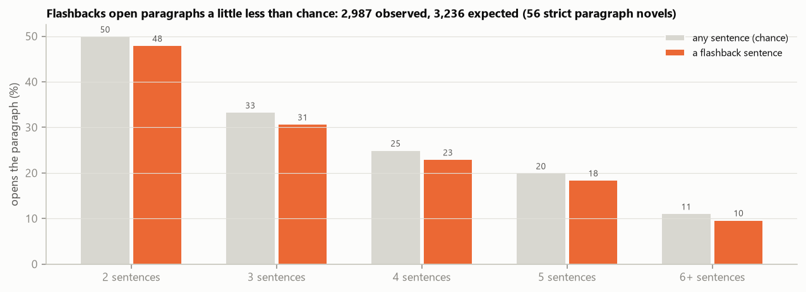

If 19th-century novelists used the paragraph break to signal a turn into
the past, flashbacks would open paragraphs more often than chance. In the
56 novels with unmistakable paragraphs, they don't. A raw comparison would
mislead: 36% of all sentences open a paragraph, because every one-line
speech in dialogue does. Matched for paragraph length (in 2-sentence
paragraphs chance is 50%, in 6+ it is 11%), flashbacks are the first
sentence **slightly less often than chance**: 2,987 against 3,236 expected,
8% fewer (z = −5.3). High-confidence flashbacks show the same tendency (192
against 216, z = −2.0).

Retrospection in these novels arrives mid-paragraph, after the present of
the scene has been established, and is folded back into it. That is the
Weeks 7-8 picture of analepsis as mostly internal and local, seen now from
the paragraph's point of view. The paragraph gathers retrospection once it
has begun (Finding #5); it doesn't announce it.

### 8. What the corpus taught the taxonomy, and what the apparatus was hiding

Testing each row against 12 million words turned up things no list
written from the armchair (or by a language model) could know:

- **Period spelling.** "Lady Day": 0 hits; "Lady-day": 14. Likewise
  "Christmas-eve", "May-day". "Next day" without "the" adds 494 forward
  jumps.
- **False friends.** 196 of 214 "lent" are the verb; all 46 "advent" mean
  arrival; 450 of 451 "Yule" are Alfred and Marian Yule of *New Grub
  Street*; "Midsummer" includes *A Midsummer Night's Dream*.
- **Words too common to be cues.** "fall" (1,554, nearly all the verb),
  "tea" (1,510, mostly the drink: "the tea-board"), "spring" (895,
  including "the repeating spring" of a watch).
- **Phrases that never occur.** "She was now ten years old", "after a
  week's journey": the examples became patterns ("was now N", "after a ...
  journey"), which do occur.
- **The period's withheld year.** "17--" and "18--" (17 instances) now
  count as year references.

The removed apparatus, meanwhile, held **174 temporal cues** the engine had
been reading as story time, among them 8 calendar dates and 37 years:

| From | What the engine had read |
|---|---|
| Anne Brontë's preface to *The Tenant of Wildfell Hall* | "July 22nd, 1848", plus edition years "September, 1920" and "June, 1996" |
| Bulwer-Lytton's prefaces to *Paul Clifford* | "July 25" (the 1840 preface's signing date) |
| Ritchie's dedication to *Old Kensington* | "March 20, 1873" |
| Scott's notes to *The Antiquary* | "in 1683", "in 1727", "the year 1753" |
| Castle Rackrent's glossary | "years ago" (twice), "formerly" (twice) |

Dr. Ross's concern that the apparatus reflects "the timelines of
publication and textual scholarship" was exactly right, and measurable.

### 9. What held, and what the timeline shows

- **The flashback that disappears.** Of 23,298 flashbacks visible at word
  scale, 36% are gone by passage scale and **72% by scene scale**, as in
  Weeks 7-8.
- **"Suddenly"** still rises (partial ρ = +0.39, p = 0.0002, robust), and
  sequence words rise with it (+0.39, p = 0.0001): narrated succession
  grows denser as the adventure romance arrives (*Doctor Moreau*, *King
  Solomon's Mines* lead). **Clock time** still rises but stays suggestive
  (+0.27, p = 0.011).
- **Lady Audley's confession.** The timeline marks Chapter XXXIV of *Lady
  Audley's Secret*, "My Lady Tells the Truth" (78% of the way through), with
  a stated span of over three years ("three years had passed", "three months
  after") and a run of flashbacks ("ever since I was a baby"): the novel's
  great analepsis, found without being told where to look.
- **Dracula's documents.** Every scene but one is a jump, and 234 dated or
  timed references run the length of the book; the dated spans show the
  overlapping diaries.

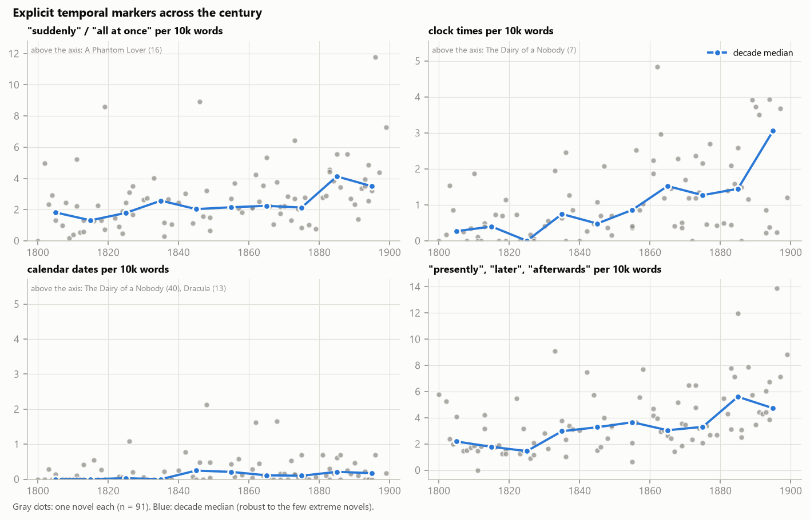

## Limitations to carry into the methodology document

- **The taxonomy's confidences are Dr. Ross's priors, lightly adjusted**,
  not measured precision.
- **Stated story time is a lower bound in principle only**: cues in
  reported speech and inscriptions count (the Dracula tombstone), and the
  dated span assumes one year per scene.
- **Iterative and seasonal cues are lexical.** Habitual "would" isn't
  detected, because it can't be told from future-in-past without syntax.
- **Paragraph-scale results depend on the transcription**: 27 of 91 lost
  their paragraphs in transcription, and 8 more keep only entries or
  sections.
- **Event-level verdicts at the middle scale are scale-dependent** (κ =
  0.37 between paragraph and passage).
- **The opening scene has no duration label**, because the engine logs a
  scene's duration on its boundary event and the first scene has none.
- **Notes removed in persona** (Castle Rackrent, King Solomon's Mines)
  await Dr. Ross's ruling; **10 stray bracket characters** remain in 9
  sentences.
- **One view of three.** Conclusions about pace still come from the corpus
  figures, not the dashboard.

## Open items / needs supervisor input

Resolved this period: multi-volume treatment (excluded), apparatus cleanup
(removed).

New:

- **Three borderline apparatus cases**: Castle Rackrent's "editor's"
  glossary and notes, the "Editor's" footnotes in *King Solomon's Mines*,
  and G. P. R. James's found-manuscript preface to *Richelieu* (it
  addresses his publisher, Mr. Colburn, by name). All three are removed for
  now.
- **Direct edits to the taxonomy.** Would Dr. Ross like to maintain
  `cue_taxonomy.csv` herself?
- **Reading the gender finding**, offered for her reading rather than as a
  conclusion.
- **The dashboard, for a first look.** Her reaction to the timeline, before
  the next two views fix the visual vocabulary, would shape them most
  cheaply now.
- **Which novels get complete publication outputs** (SOW: 5-10). The Weeks
  7-8 candidates still stand; *Lady Audley's Secret* has earned a place.
- **The comparative view** (SOW: optional): keep it, or trim it to protect
  the pace plot and flashback map?

## How to reproduce

```bash
python -m src.build_pipeline                 # rebuild without apparatus
python -m src.enrich_metadata "data/raw/_description/HUM19UK Corpus Contents.pdf"
python -m src.verify
python -m src.analyze_temporal               # all 91 novels, incl. the paragraph scale (~1 h)
python -m src.verify_phase2 --require-full
python -m src.analyze_temporal_corpus        # reports/data/temporal_*
python -m src.compare_middle_scale           # reports/data/middle_scale_*
python -m src.plot_phase2                    # reports/figures/phase2/
python -m src.export_figures                 # timelines -> reports/figures/phase3/
python -m src.dashboard                      # http://127.0.0.1:8050
```

## Next steps (Phase 3, Weeks 11-12)

- **Pace/density plot.** The SOW's "narrative seconds per page vs. story
  time per page": discourse length against stated story time along the
  novel, from `granularity_units` and the dated spans.
- **Flashback map.** High-confidence flashbacks as events over the
  low-confidence density, at a stated scale, as a second dashboard tab.
- **Publication figures for 5-10 novels across all three views**, chosen
  with Dr. Ross.
- **Opening-scene labels**, so every scene on the timeline has one.
