# Weeks 11-12 — Phase 3 complete: pace, flashbacks, and a gender finding tested to journal standard

**Period:** Weeks 11-12 (2026-11-10 to 2026-11-23); report filed 2026-11-24
**SOW phase:** Phase 3 — Visualization Suite (Weeks 8-12) — **complete**, on schedule; Phase 4 (Weeks 13-15) begins

## Summary

Two things were asked of this period: finish Phase 3, and, from the
supervisor meeting, take the gender difference found in Weeks 9-10 to
journal level (the side-by-side comparative view was dropped at the same
meeting). Both are done.

**Phase 3 is complete.** The dashboard now carries all three of the SOW's
views for any of the 91 novels, as tabs: the **timeline** (Weeks 9-10),
the **pace/density plot**, and the **flashback map**. Every view exports
to SVG, PDF, and PNG at publication size, from the dashboard or in batch,
and all three views are exported for a publication set of 9 novels (81
files). A link can now open a given novel and view directly, for teaching.
The opening scene of every novel, unlabelled until now, has a duration
label.

The new views earned their place at once:

- **The pace plot shows Victorian narration speeding up.** Story time per
  1,000 words, measured scene by scene, roughly triples across the century
  (decade medians 0.4 days in the 1810s-1830s, 1.2 in the 1890s; ρ = +0.34,
  p = 0.002, unchanged with sentence length or scene length controlled).
  The fastest tellers are Wells, Conan Doyle, and Thackeray; the slowest
  include Broughton's present-tense *Red as a Rose is She*.
- **The flashback map puts the project's central finding on each novel's
  own page.** Every high-confidence flashback is drawn filled if it
  survives at a chosen scale, hollow if it washes out. In *Wuthering
  Heights* 1 of 13 survives at scene scale; in *Lady Audley's Secret* 11 of
  24, clustered in the confession.

**The gender finding holds to journal standard, and grows stronger.**
Before testing it further, 130 detections were checked by hand. The
check showed that the cue patterns were, if anything, less precise in
men's novels, and it fixed the false positives it found ("too long used
to", "the spring of her mind"). On the corrected corpus:

| | Women (median per 10k words) | Men | Rate ratio, fully controlled | p |
|---|---|---|---|---|
| Iterative cues ("used to", "usually", "every day") | 4.39 | 3.28 | **1.46** (1.24-1.72) | 4 × 10⁻⁶ |
| Seasonal cues ("the summer", "in the winter") | 1.00 | 0.54 | **2.04** (1.47-2.84) | 2 × 10⁻⁵ |

Both differences survive a permutation test that shuffles gender only
within decades, count models controlling for year, sentence length,
first-person narration, and dialogue, the removal of any single novel or
any whole decade, and the worst case of the precision check. They hold in
narration and in dialogue, show no change across the century, and, in
the case of iterative cues, spread across every kind of habitual
expression rather than resting on one phrase. One control works *against*
the finding: women's novels use less first-person narration, which on its
own raises iterative cues, so accounting for it makes the gap larger.

## Timeline

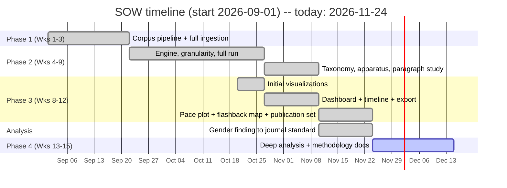

Phase 3 closes at the end of week 12, as the SOW schedules it. The
optional comparative view was dropped at the supervisor meeting, which
freed the time for the gender analysis.

## Architecture & Code

### Repository structure and commit history

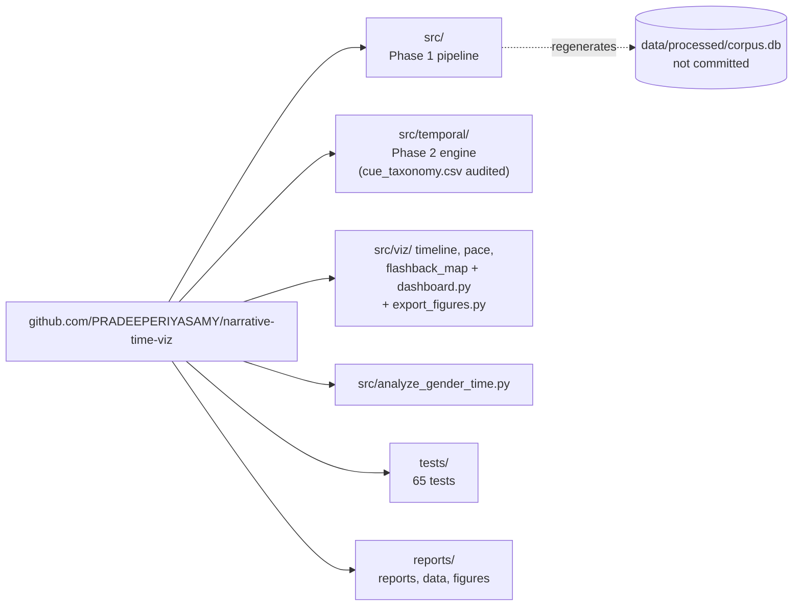

Commits 1-43 cover Phases 1-2 and the start of Phase 3. This period adds:

| # | Commit | What it added |
|---|---|---|
| 44 | `docs: pin Weeks 9-10 report figures to its own run` | `reports/weeks-09-10.md`, `reports/figures/weeks-09-10/` |
| 45 | `fix: tighten iterative and seasonal cues after a precision audit` | `src/temporal/cue_taxonomy.csv`, `tests/test_temporal.py`, `reports/data/gender_precision_audit.csv` |
| 46 | `feat: label the opening scene; pace and flashback-map data` | `src/viz/data.py` |
| 47 | `feat: pace/density plot and flashback map` | `src/viz/pace.py`, `src/viz/flashback_map.py`, `tests/test_viz.py` |
| 48 | `feat: three-view dashboard, shareable links, batch export` | `src/dashboard.py`, `src/export_figures.py`, `reports/figures/phase3/` |
| 49 | `feat: gender analysis of iterative and seasonal time` | `src/analyze_gender_time.py`, `requirements.txt`, `reports/data/gender_time*` |
| 50 | `chore: refresh corpus outputs after the audit re-run` | `reports/data/temporal_*`, `reports/figures/phase2/` |
| 51 | `docs: biweekly progress report for Weeks 11-12` | `reports/weeks-11-12.md`, `reports/figures/weeks-11-12/` |
| 52 | `docs: update README for Phase 3 completion` | `README.md` |

Commit 44 applies the rule adopted in Weeks 9-10, that each report keeps
its own figures, to the two Phase 3 images the Weeks 9-10 report embeds,
since this period's exports regenerated them.

### The complete Phase 3 suite

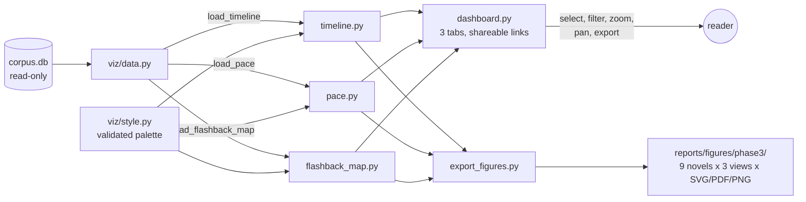

Each view is a pure function from one novel's data to a Plotly figure, so
the dashboard and the batch exporter draw the same thing. All three read
the database read-only, and all three share the novel's length (% of its
words) as their horizontal axis, so a reader can move between views
without re-orienting.

### The pace/density plot (`viz/pace.py`)

The SOW asks: "where does narrative time accelerate or slow? (narrative
seconds per page vs. story time per page)". That ratio is what Genette
calls *speed*: story time over discourse time.

| Row | Measures | Encoding |
|---|---|---|
| pace | story days per 1,000 words, scene by scene | one horizontal step per scene, coloured by duration label, on a log axis from 15 minutes to 3 years; the novel's own median dotted, with "faster (summary)" above and "slower (scene)" below |
| time cues | temporal cues per 1,000 words, per 10-sentence passage | smoothed line, about 1,800 words wide |
| iterative narration | habitual cues per 1,000 words, per passage | smoothed line |

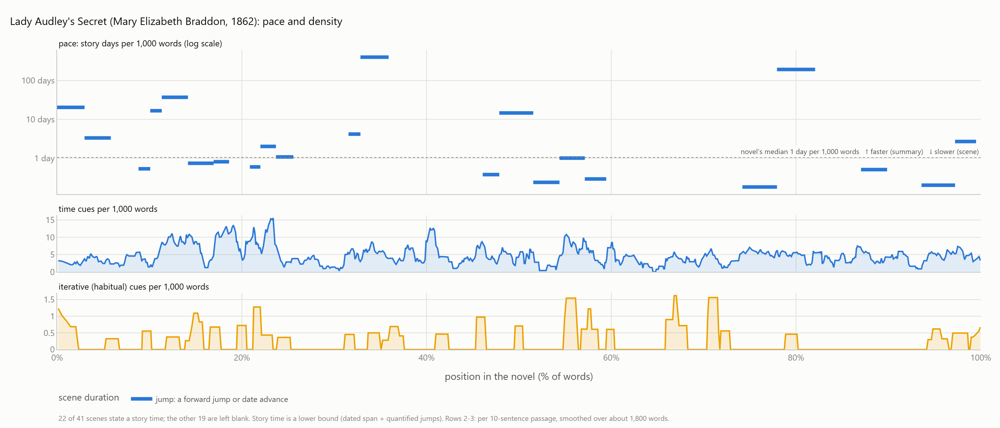

Discourse time is measured in words (1,000 words is about three printed
pages, or four minutes of reading). Story time is the scene's dated span
plus its quantified jump cues, as on the timeline. Two design decisions
keep the plot honest:

- **Scenes that state no story time are left blank, not drawn as zero.** A
  scene without a stated interval isn't a scene in which no time passes;
  the plot says how many scenes it can and can't time.
- **Pace is read against the novel's own median**, because "fast" means
  different things in Dracula's diary and in a three-generation family saga.

The iterative row matters because iteration is a speed of its own: one
sentence of "she used to walk there every evening" tells a whole season,
and no interval in days captures it.

### The flashback map (`viz/flashback_map.py`)

The SOW asks for flashback and flash-forward annotations "with clear
visual distinction".

| Row | Shows | Encoding |
|---|---|---|
| density | all flashbacks and flash-forwards, every confidence level, per 1,000 words | mirrored: flashbacks above the axis in orange, flash-forwards below in blue |
| events | the high-confidence ones | ◀ for flashbacks, ▶ for flash-forwards; **filled if still visible at the chosen scale, hollow if washed out** |
| scenes | scene boundaries for orientation | neutral grey, so orange and blue keep one meaning |

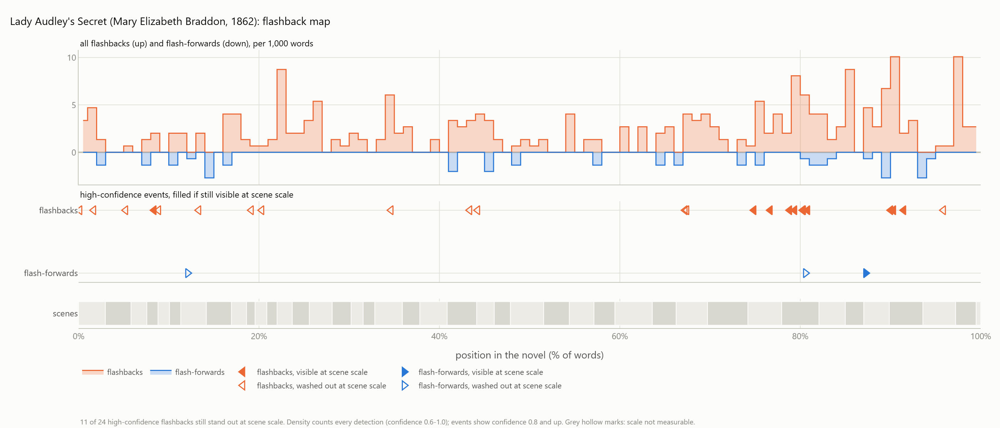

The filled/hollow encoding is the project's central result made legible
per novel. The Weeks 7-8 report found that most flashbacks visible at
word scale vanish at scene scale; here a reader sees *which* ones, and can
switch the scale (word, paragraph, passage, scene) to watch them appear
and disappear. Because the Weeks 9-10 study showed that verdicts differ
between middle scales (κ = 0.37), the scale is always stated on the
figure.

### The dashboard

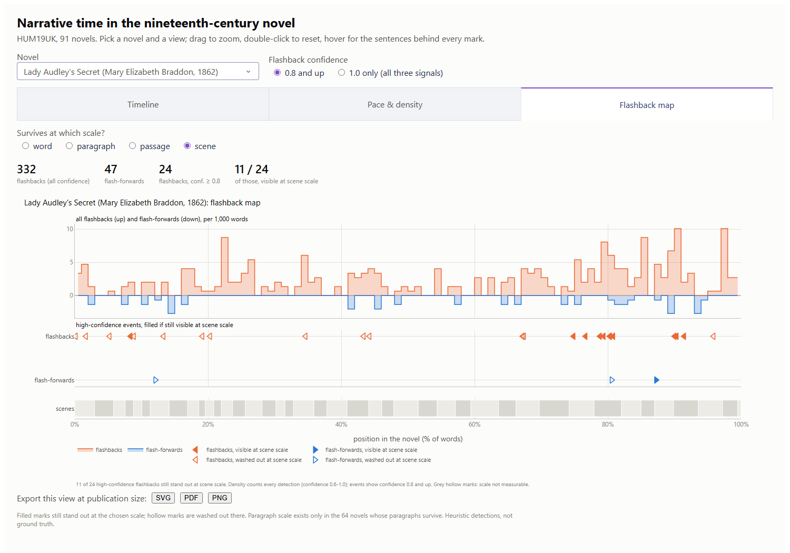

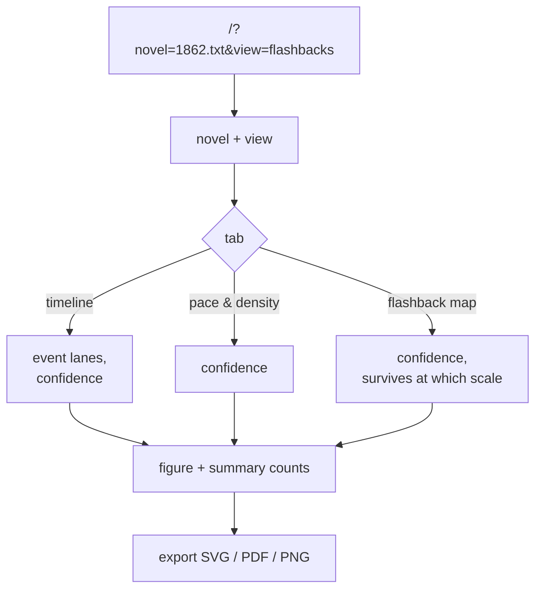

Each tab shows only the controls that apply to it and its own summary
strip: label mix and event counts for the timeline; timed scenes, median
pace, and the fastest and slowest scene for pace; flashbacks and how many
survive at the chosen scale for the map. The **shareable link** (for
example `/?novel=1862.txt&view=flashbacks`) opens a novel and view
directly, so a seminar handout can point at Lady Audley's confession.

| | | |
|---|---|---|
| 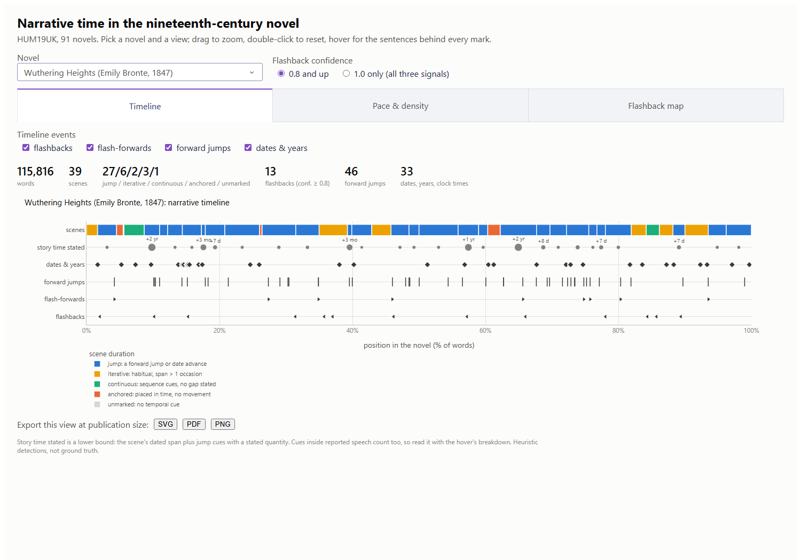 | 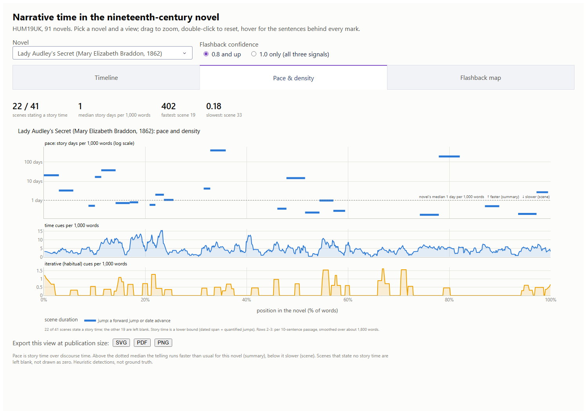 |  |

### Every scene has a label

The engine records a scene's duration label on its boundary event, and the
opening scene has no boundary, so until now every novel's first scene was
unlabelled. The data layer now labels it from its own cues by the engine's
own rule. Across the 91 novels the opening scenes are 44 jump, 25
iterative, 10 anchored, 7 continuous, and 5 unmarked. A quarter of these
novels begin in the iterative: they open with the way things used to be
before the story's first event.

### The publication set

All three views are exported as SVG, PDF, and PNG for 9 novels (SOW:
"publication-quality figures for 5+ novels"), in `reports/figures/phase3/`:

| Novel | Why it's in the set |
|---|---|
| *Fleetwood* (Godwin, 1805) | test novel; the reliably paginated case |
| *Wuthering Heights* (E. Brontë, 1847) | test novel; frame narration |
| *Alice's Adventures in Wonderland* (Carroll, 1865) | test novel; the Mad Tea-Party's clock |
| *Black Beauty* (Sewell, 1877) | test novel; among the corpus's three most iterative novels |
| *Dracula* (Stoker, 1897) | test novel; dated documents |
| *Lady Audley's Secret* (Braddon, 1862) | the confession's analepsis |
| *The Diary of a Nobody* (Grossmith, 1892) | dates and clock time |
| *Red as a Rose is She* (Broughton, 1870) | present-tense narration; among the slowest |
| *A Phantom Lover* (Vernon Lee, 1886) | "suddenly" |

Phase 4's 5-10 fully analyzed novels will be chosen from these with Dr.
Ross.

### The precision audit and the re-run

To test the gender finding, 130 detections were drawn at random,
stratified by gender (40 iterative and 25 seasonal from each), and each was
read and judged; 8 too truncated to judge were set aside. Every judgment
and its reason are in `reports/data/gender_precision_audit.csv`.

| Cue family | Women: correct / judged | Men: correct / judged |
|---|---|---|
| iterative | 35 / 39 (90%) | 31 / 36 (86%) |
| seasonal | 21 / 24 (88%) | 17 / 23 (74%) |

The errors fell into patterns the vocabulary could exclude, so it was
tightened and the full corpus re-run (33 minutes; `verify_phase2
--require-full` passes):

| False positive found | Fix in `cue_taxonomy.csv` |
|---|---|
| "too long used to", "grow used to", "He's used to it" (accustomed) | "used to" also skipped after *long*, *grow*, *'s*, *being* |
| "he ain't what he used to be" (a past state) | "used to be" skipped |
| "a more than usually severe winter" (degree) | "than usually" skipped |
| "the spring of her mind", "the autumn of her days" (metaphor) | a season followed by "of" skipped, unless "of the year" or a year |
| "even in spring-tides" | "spring-tide(s)" skipped |

The fixes removed 307 iterative cues (5,433 to 5,126, mostly the
"accustomed" sense of "used to") and 57 seasonal cues (1,380 to 1,323).
Events carrying the multi-unit modifier fell from 7,522 to 7,170, and
explicit-marker sentences from 40,497 to 40,200. Every other count is
unchanged, and so is every other finding in the Weeks 9-10 report.

### Test coverage

5 new tests this period, 65 in the suite overall (9 Phase 1, 48 Phase 2, 8
Phase 3), all passing:

| Test | Verifies |
|---|---|
| `test_audit_false_positives_are_not_cues` | every audited false positive is no longer a cue |
| `test_audit_keeps_true_habits_and_seasons` | "she used to read", "the spring of the year" still are |
| `test_opening_scene_is_labelled_from_its_own_cues` | the first scene gets a label by the engine's rule |
| `test_pace_is_story_time_over_discourse_time` | 6 story days in 600 words = 10 per 1,000; iterative density per passage |
| `test_flashback_map_marks_washed_out_events_hollow` | a flashback washed out at scene scale is drawn hollow |

## What was done

- **Built the pace/density plot and the flashback map**, the SOW's second
  and third views, and put all three views in the dashboard as tabs, with
  per-view controls, summary counts, and export.
- **Added shareable links** to the dashboard (`?novel=...&view=...`).
- **Labelled every novel's opening scene** from its own cues.
- **Exported the publication set**: 9 novels × 3 views × SVG/PDF/PNG.
- **Took the gender finding to journal standard** (`analyze_gender_time.py`):
  a hand-checked precision audit; effect sizes with bootstrap intervals; a
  within-decade permutation test; negative binomial count models with four
  controls and an interaction; leave-one-out stability; cue-family
  decomposition with FDR correction; narration vs. dialogue.
- **Tightened the vocabulary from the audit** and re-ran the full corpus;
  `verify_phase2 --require-full` passes and all 65 tests pass.
- **Tested whether narrative pace changes across the century** (Findings #2).

## Decisions made

- **The comparative view is dropped**, as agreed at the supervisor
  meeting; the time went to the gender analysis.
- **Pace in story days per 1,000 words**, not per printed page: only 5
  novels have reliable pages, and words are comparable across all 91.
- **Untimed scenes left blank** on the pace plot, never drawn as zero.
- **Filled/hollow by chosen scale** on the flashback map, with the scale
  always stated.
- **Audit before modelling.** The gender difference was not modelled until
  a hand check had shown the cues were about equally precise for both
  groups (if anything less precise for men).
- **Count models with exposure**, not tests on rates alone: a negative
  binomial regression of each novel's cue count with its length as
  exposure gives an interpretable rate ratio and admits controls.
- **Controls chosen for a reason**: year (the corpus spans a century of
  change), sentence length (the Weeks 7-8 confound), first-person
  narration (a memoir says "I used to"), and dialogue share (characters
  talk about their habits).
- **No author clustering needed**: every author in the corpus appears once.

## Current state vs. SOW

| Phase 3 duty | Status |
|---|---|
| Timeline view | **Done** (Weeks 9-10) |
| Pace/density plot | **Done** |
| Flashback map | **Done** |
| Comparative view (optional) | **Dropped** at the supervisor meeting |
| Interactive dashboard, navigable | **Done**: 3 views, all 91 novels, shareable links |
| Export to SVG/PDF | **Done**, in the dashboard and in batch |
| Simple UI: select → view → zoom/pan → export | **Done** |

| Phase 3 deliverable | Status |
|---|---|
| Working visualization dashboard | **Done** |
| Publication-quality figures for 5+ novels | **Done**: 9 novels, all three views, SVG/PDF/PNG |
| Screenshots and exports for teaching and research | **Done**: `reports/figures/phase3/` |

| SOW success criterion | Status |
|---|---|
| HUM19UK corpus preprocessed and stored | **Met** |
| Engine detects at least 4 feature types | **Met** |
| Output structured and reproducible for any novel | **Met** |
| At least 3 visualization types implemented and working | **Met** |
| Interactive dashboard can display visualizations for any novel | **Met** |
| 5-10 novels with complete, publication-quality outputs | **Met** for the figures (9 novels); Phase 4 adds the analysis |
| Code documented and reproducible from scratch | **Met**; final cleanup in Phase 4 |
| Methodology document | Phase 4 |

Phase 3 is complete. The remaining criterion, the methodology document, is
Phase 4's.

## Findings

Numbers come from `reports/data/gender_time.json`,
`reports/data/gender_time_by_novel.csv`,
`reports/data/gender_precision_audit.csv`, and
`reports/data/temporal_corpus_summary.json`, all regenerated on this
period's corpus.

### 1. Iterative and seasonal time by author gender: tested to journal standard

The corpus's 91 eligible novels are by 47 women and 44 men, each author
represented once, about five of each per decade. Weeks 9-10 found that
women's novels carry more iterative and seasonal cues. This period put
the finding through the tests a referee would ask for.

#### Measurement

A difference in a detected rate can be an artifact of the detector. So
before any modelling, 130 detections were read and judged (the precision
audit above). The patterns were about equally precise for both groups,
and where they differed, they were *less* precise in men's novels (74% vs.
88% for seasonal cues). False positives therefore inflate men's rates more
than women's, which works against the finding. The audit's error patterns
were then removed from the vocabulary and the corpus re-run, and every
result below is on the corrected data.

Applying each group's measured precision gives estimated true rates of
3.94 vs. 2.82 per 10k words (iterative) and 0.87 vs. 0.40 (seasonal). Even
in the worst case for the finding (women's precision at the bottom of its
95% interval, men's at the top), women's novels still lead: 3.36 vs. 3.08,
and 0.69 vs. 0.47.

#### Effect sizes and the design-based test

| | Women | Men | Mann-Whitney p | Rank-biserial r | Hodges-Lehmann shift (95% CI) | Within-decade permutation p |
|---|---|---|---|---|---|---|
| Iterative cues per 10k words | 4.39 | 3.28 | 0.0012 | 0.40 | +1.09 (0.46 to 1.76) | 0.0004 |
| Seasonal cues per 10k words | 1.00 | 0.54 | 0.0006 | 0.42 | +0.47 (0.22 to 0.77) | 0.0007 |

The rank-biserial correlation of about 0.4 is a medium effect: a novel by
a woman picked at random has a higher iterative rate than one by a man
about 70% of the time. The permutation test shuffles gender only within
each decade, so the comparison is always between novels of the same
decade; it agrees with the unstratified test.

#### Controls

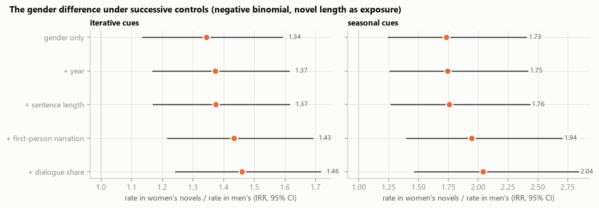

Negative binomial regression of each novel's cue count, with its length as
exposure, gives the rate in women's novels relative to men's (the
incidence-rate ratio, IRR):

| Model | Iterative IRR (95% CI) | p | Seasonal IRR (95% CI) | p |
|---|---|---|---|---|
| gender only | 1.34 (1.14-1.59) | 0.0006 | 1.73 (1.25-2.40) | 0.001 |
| + year | 1.37 (1.17-1.61) | 0.0001 | 1.75 (1.26-2.41) | 0.0008 |
| + sentence length | 1.37 (1.17-1.61) | 0.0001 | 1.76 (1.27-2.43) | 0.0007 |
| + first-person narration | 1.43 (1.22-1.69) | 0.00002 | 1.94 (1.40-2.70) | 0.00007 |
| + dialogue share | **1.46 (1.24-1.72)** | **0.000004** | **2.04 (1.47-2.84)** | **0.00002** |

No control explains the difference away; each one leaves it the same or
larger. The reason is instructive. Women's novels in this corpus use *less*
first-person narration than men's (13.4 vs. 19.1 first-person pronouns
per 1,000 words of narration, p = 0.02), and first-person narration
raises iterative and seasonal cues on its own (the memoirist's "I used
to"). The plausible confound therefore runs the other way: once it is held
constant, the gender difference grows. Neither sentence length nor dialogue
share has a significant effect.

**Change over time.** Adding a gender × year interaction to the full model
finds none (iterative: IRR per decade 1.01, p = 0.64; seasonal: 1.07, p =
0.28). The gap is as wide at the end of the century as at the beginning.

#### Stability

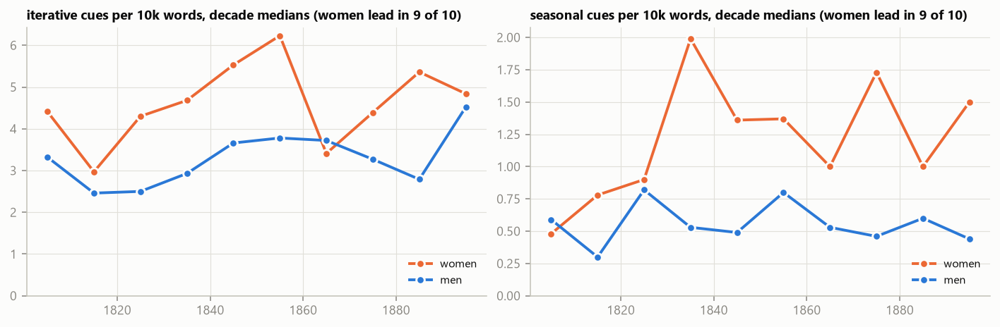

| | Iterative | Seasonal |
|---|---|---|
| Decades in which women's median is higher | 9 of 10 (not the 1860s) | 9 of 10 (not the 1800s) |
| Largest p after removing any one novel | 0.002 | 0.0009 |
| Largest p after removing any one whole decade | 0.007 | 0.006 |

No single novel and no single decade carries the result.

#### Where the difference lives

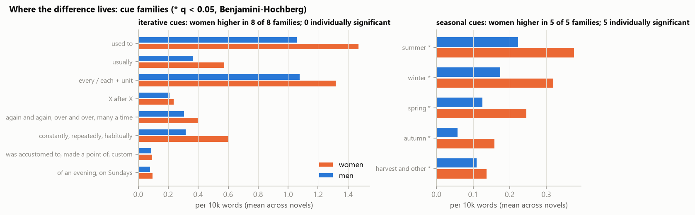

- **Iterative cues: everywhere at once.** Women's novels lead in all 8
  families of habitual expression ("used to", "usually", "every"/"each" +
  a unit, "day after day", "again and again", "constantly"/"habitually",
  "was accustomed to", "of an evening"), but no single family is
  significant on its own after false-discovery-rate correction. The
  difference is not a fondness for one phrase. It is a general disposition
  toward telling time as habit.
- **Seasonal cues: every season.** All five families (summer, winter,
  spring, autumn, harvest and others) differ significantly after
  correction. Women's novels name the year's round, all of it.

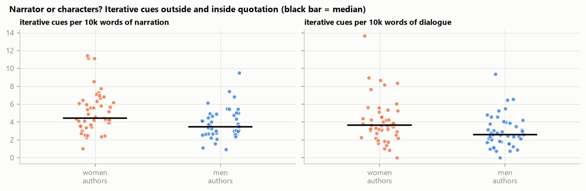

- **Narrator and characters alike.** The iterative difference holds in
  narration (4.40 vs. 3.44 per 10k words of narration, p = 0.003) and in
  dialogue (3.64 vs. 2.57 per 10k words of dialogue, p = 0.01). The
  seasonal difference does too (narration p = 0.005, dialogue p = 0.002).
  It is not a matter of narrators alone (Genette's iterative narration)
  nor of characters' talk alone, but of the whole texture of the novels.
- **Not at scene level.** The share of whole scenes labelled iterative
  differs less (25% vs. 21%, p = 0.10). The difference lives in the
  density of habitual time within scenes rather than in the scene
  structure.

#### What it might mean, and what it can't yet claim

The result is robust: a difference of about 45% in iterative time and
about 100% in seasonal time, after controls, in a balanced corpus, stable
across the century. What it *means* is a question for literary history,
and the measurement constrains the answer more than it supplies one. It
is not a matter of narrative person, dialogue, sentence style, or date,
and it is not one stock phrase. It is a broad preference, across a
century of women's fiction, for time told as recurrence, habit, and
season: the year's round as against the dated event. That invites
comparison with accounts of cyclical, repetitive time as a dimension of
women's experience and writing (Kristeva's "Women's Time"), and with the
domestic novel's investment in routine. Whether it reflects subject
matter, genre, readership, or a formal choice is the next question, and
one for close reading.

Limits a referee would raise, stated in advance:

- **Genre is not controlled.** The corpus records no genre, and genre is
  plausibly entangled with gender in the period (domestic fiction,
  children's fiction). Coding genre for 91 novels is a natural next step.
- **Iterative "would" is not detected.** The commonest English form of
  habitual narration ("she would walk there of an evening") can't be told
  from future-in-past "would" without syntax, so the measure covers
  lexical iteration only.
- **One annotator, a sample of 130.** The precision estimates have wide
  intervals; a second annotator and a larger sample would tighten them.
- **91 novels, one per author.** Balanced by design, but not a random
  sample of Victorian fiction.

### 2. Victorian narration speeds up

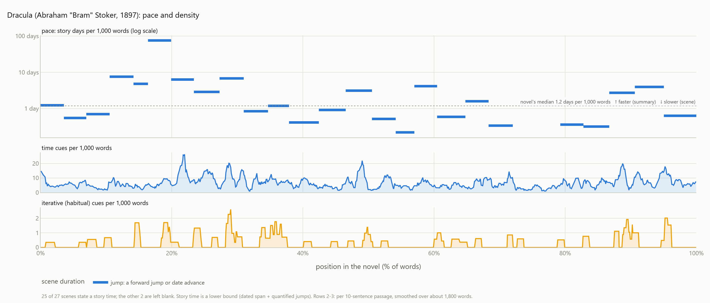

With a story-time pace for every scene that states one, the corpus can be
asked whether narrative speed changes across the century. In the 82 novels
with at least three timed scenes, it does:

| Decade | Median pace (story days per 1,000 words) |
|---|---|
| 1800s | 0.63 |
| 1810s | 0.40 |
| 1820s | 0.42 |
| 1830s | 0.42 |
| 1840s | 0.73 |
| 1850s | 1.05 |
| 1860s | 0.66 |
| 1870s | 0.46 |
| 1880s | 0.86 |
| 1890s | 1.18 |

The rank correlation with year is ρ = +0.34 (p = 0.002), and it holds with
sentence length controlled (partial ρ = +0.31, p = 0.004) and with scene
length controlled (+0.34, p = 0.002). It is not that later novels state
story time more often: the share of scenes that state any time is flat
across the century (ρ = 0.03). When they do state it, later novels cover
more story per word.

The fastest novels are *The Island of Doctor Moreau* (30 story days per
1,000 words), *The Sign of the Four* (18), and *Barry Lyndon* (16); the
slowest include *The Loyalists* (0.16), *Vice Versa* (0.17), and
*Red as a Rose is She* (0.23). Broughton's present-tense novel, singled out
in Weeks 7-8, is slow in exactly the way its tense suggests: only 8 of its
55 scenes state any story time at all.

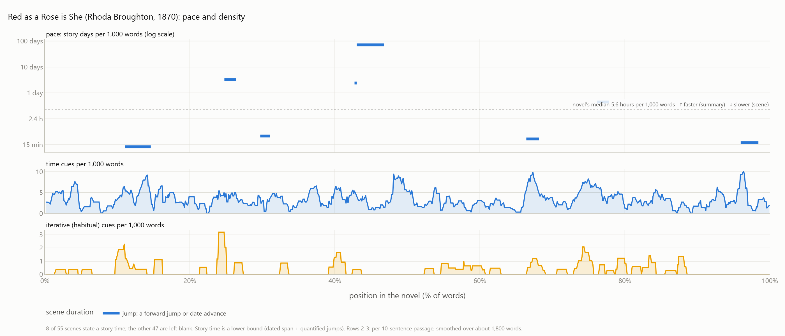

The trend belongs with three others: "suddenly" rising, sequence words
("presently", "later") rising, and clock time rising (suggestive). Together
they describe a late-century narrative that moves faster and marks its
moments more sharply. This is one exploratory test, not part of a
corrected family, so it is offered as a finding to test in Phase 4 rather
than a result.

### 3. The flashback map, novel by novel

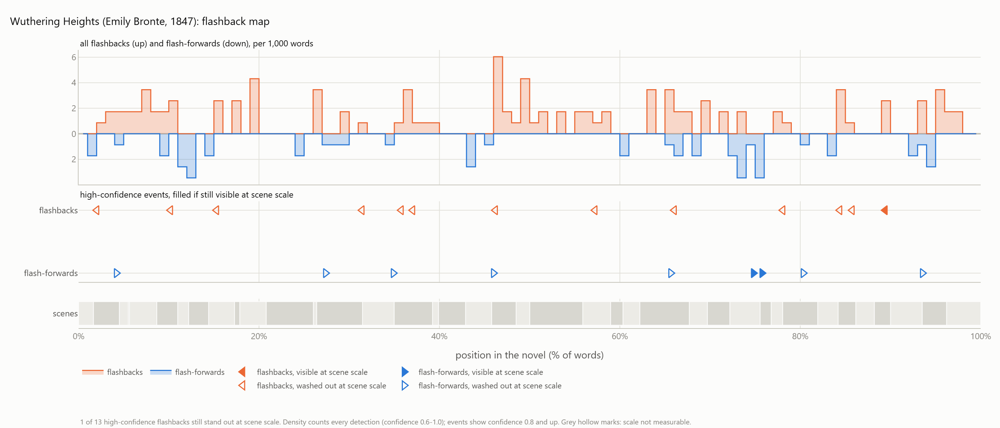

The map turns the corpus result into something a reader can check against
a novel they know:

- *Wuthering Heights*: 114 flashbacks, 13 at high confidence, and **1** of
  those 13 still visible at scene scale. Retrospection is pervasive in
  Nelly's telling, and that is exactly why no single return to the past
  stands out against the chapter around it.
- *Lady Audley's Secret*: 11 of 24 high-confidence flashbacks survive at
  scene scale, clustered after 75% of the novel: the confession and its
  aftermath, where the past becomes the subject of whole chapters.
- *Dracula*: 1 of 12 survives at scene scale. Its retrospection is local,
  inside dated entries.

The proportion that survives is a measure of how a novel *uses* the past:
diffused through the narration, or gathered into set pieces.

### 4. What the re-run left standing

The audit's fixes touched only iterative and seasonal cues, and every
other finding is unchanged on the corrected corpus: retrospection's
register shift (Weeks 9-10, original phrases partial ρ = +0.44, Latinate
additions −0.34), "suddenly" (+0.39), sequence words (+0.39), recollection
(−0.32), the flashback washout (72% of word-visible flashbacks gone at
scene scale), and the paragraph-vs-passage comparison. Scene labels shift
slightly: 52% jump, 23% iterative, 10% anchored, 9% continuous, 6%
unmarked.

## Limitations to carry into the methodology document

- **Pace depends on stated story time**, which is a lower bound in
  principle and inflated wherever characters talk about other times
  (Weeks 9-10); scenes that state no time can't be placed on the pace plot.
- **The flashback map's verdicts depend on the chosen scale**, which is
  why the scale is always stated.
- **The gender analysis has no genre control** and measures lexical
  iteration only (no habitual "would"); its precision rests on one
  annotator and 130 items.
- **Earlier limitations stand**: heuristic detections, no hand-annotated
  gold standard for the detectors as a whole, coarse scenes in most novels.

## Open items / needs supervisor input

- **The gender finding: next steps toward publication.** The analysis is
  ready to be written up. Two additions would most strengthen it: genre
  coding for the 91 novels, which Dr. Ross is far better placed to do than
  any heuristic, and a second annotator for the precision audit.
- **Phase 4's 5-10 novels.** The publication set above is the proposal;
  Dr. Ross's choice decides it.

## How to reproduce

```bash
python -m src.analyze_temporal               # all 91 novels (~35-65 min)
python -m src.verify_phase2 --require-full
python -m src.analyze_temporal_corpus        # reports/data/temporal_*
python -m src.analyze_gender_time            # reports/data/gender_time*, figures/weeks-11-12/
python -m src.plot_phase2                    # reports/figures/phase2/
python -m src.export_figures                 # 9 novels x 3 views -> reports/figures/phase3/
python -m src.dashboard                      # http://127.0.0.1:8050
```

## Next steps (Phase 4, Weeks 13-15)

- **Deep analysis of 5-10 novels**, chosen with Dr. Ross, with final
  visualizations from all three views.
- **The methodology document** (SOW): the heuristic approach and why,
  each detector and its limitations (gathered in these reports), how to
  reproduce, and recommendations for future work.
- **The gender finding as a draft paper section**, if Dr. Ross agrees,
  with genre coding as its first addition.
- **Code cleanup and a final README.**
